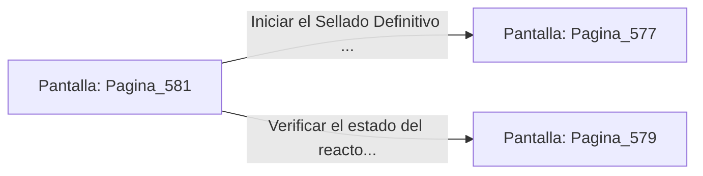

# 📺 Nodo Pantalla: `Pagina_581`

[[Index|⬅️ Índice]] | Fichero Origen: [[sample_eligejuego-code_capitulo_30_mpl|📄 sample/eligejuego-code/capitulo_30.mpl]]

**Narrativa y Encabezado:**
> PÁGINA 581: LA ESTABILIZACIÓN SUPERIOR
> 
> Operas las válvulas de derivación en las pasarelas superiores, asegurando la presión de los condensadores antes del cierre definitivo.
> 
> Desciendes a la plataforma central con la absoluta certeza de que el sistema responderá sin margen de error a la orden de purga.
> 
> Insertas la Tarjeta de Nivel Doce e inicias el proceso de Sellado Definitivo.

## 📋 Desglose de Instrucciones de Opciones
### `OPCION "Iniciar el Sellado Definitivo en la consola central" CON_ACCION TRANSICIONAR_A Pagina_577`
* **Instrucción:** `OPCION` *(Manual: Mapea una entrada o botón interactivo de usuario. Vincular una acción como la invocación de una función C1, un método C2 o una transición C3.)*
* **Efecto de Control:** Dispara `TRANSICIONAR_A` hacia [[Pantalla_Pagina_577|📺 Pagina_577]]
### `OPCION "Verificar el estado del reactor en el panel secundario" CON_ACCION TRANSICIONAR_A Pagina_579`
* **Instrucción:** `OPCION` *(Manual: Mapea una entrada o botón interactivo de usuario. Vincular una acción como la invocación de una función C1, un método C2 o una transición C3.)*
* **Efecto de Control:** Dispara `TRANSICIONAR_A` hacia [[Pantalla_Pagina_579|📺 Pagina_579]]

## 📊 Diagrama de Flujo e Interacción (Mermaid)

