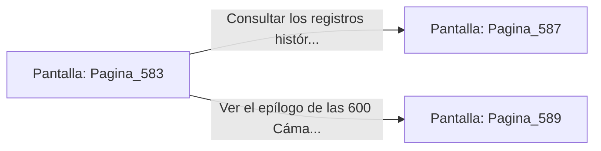

# 📺 Nodo Pantalla: `Pagina_583`

[[Index|⬅️ Índice]] | Fichero Origen: [[sample_eligejuego-code_capitulo_30_mpl|📄 sample/eligejuego-code/capitulo_30.mpl]]

**Narrativa y Encabezado:**
> PÁGINA 583: EL AMANECER EN AETHELGARD
> 
> Sales a la gran balconada de la Torre del Trono. La tormenta de éter que oscureció el cielo durante siglos se disipa por completo, dejando ver los rayos de un nuevo sol artificial dorando las agujas y puentes de la ciudadela subterránea.
> 
> Desde todas las galerías y naves inferiores resuenan los ecos de los sistemas al despertar en armonía. La era del miedo y la corrupción ha llegado a su fin.
> 
> Te yaces sobre la balaustrada contemplando el fruto de tu determinación, sabiendo que tu nombre será recordado en cada tomo de Aethelgard.

## 📋 Desglose de Instrucciones de Opciones
### `OPCION "Consultar los registros históricos finales (Página 587)" CON_ACCION TRANSICIONAR_A Pagina_587`
* **Instrucción:** `OPCION` *(Manual: Mapea una entrada o botón interactivo de usuario. Vincular una acción como la invocación de una función C1, un método C2 o una transición C3.)*
* **Efecto de Control:** Dispara `TRANSICIONAR_A` hacia [[Pantalla_Pagina_587|📺 Pagina_587]]
### `OPCION "Ver el epílogo de las 600 Cámaras (Página 589)" CON_ACCION TRANSICIONAR_A Pagina_589`
* **Instrucción:** `OPCION` *(Manual: Mapea una entrada o botón interactivo de usuario. Vincular una acción como la invocación de una función C1, un método C2 o una transición C3.)*
* **Efecto de Control:** Dispara `TRANSICIONAR_A` hacia [[Pantalla_Pagina_589|📺 Pagina_589]]

## 📊 Diagrama de Flujo e Interacción (Mermaid)

