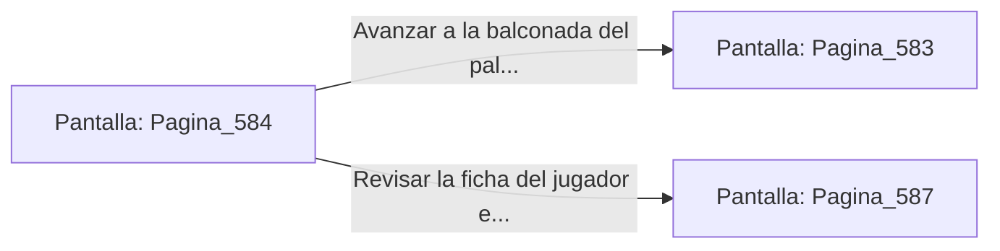

# 📺 Nodo Pantalla: `Pagina_584`

[[Index|⬅️ Índice]] | Fichero Origen: [[sample_eligejuego-code_capitulo_30_mpl|📄 sample/eligejuego-code/capitulo_30.mpl]]

**Narrativa y Encabezado:**
> PÁGINA 584: EL LEGADO DE LOS TRES SELLOS
> 
> Los tres sellos de fase en tu Brazal emiten un suave resplandor dorado antes de integrarse de forma permanente en la estructura del reactor Maestro.
> 
> Tu dispositivo registra el cumplimiento absoluto de la misión suprema.

## 📋 Desglose de Instrucciones de Opciones
### `OPCION "Avanzar a la balconada del palacio a contemplar la ciudadela" CON_ACCION TRANSICIONAR_A Pagina_583`
* **Instrucción:** `OPCION` *(Manual: Mapea una entrada o botón interactivo de usuario. Vincular una acción como la invocación de una función C1, un método C2 o una transición C3.)*
* **Efecto de Control:** Dispara `TRANSICIONAR_A` hacia [[Pantalla_Pagina_583|📺 Pagina_583]]
### `OPCION "Revisar la ficha del jugador en el Brazal" CON_ACCION TRANSICIONAR_A Pagina_587`
* **Instrucción:** `OPCION` *(Manual: Mapea una entrada o botón interactivo de usuario. Vincular una acción como la invocación de una función C1, un método C2 o una transición C3.)*
* **Efecto de Control:** Dispara `TRANSICIONAR_A` hacia [[Pantalla_Pagina_587|📺 Pagina_587]]

## 📊 Diagrama de Flujo e Interacción (Mermaid)

