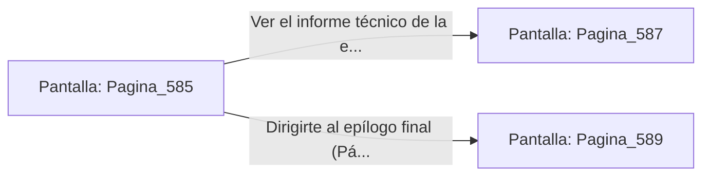

# 📺 Nodo Pantalla: `Pagina_585`

[[Index|⬅️ Índice]] | Fichero Origen: [[sample_eligejuego-code_capitulo_30_mpl|📄 sample/eligejuego-code/capitulo_30.mpl]]

**Narrativa y Encabezado:**
> PÁGINA 585: EL MONUMENTO DE LA CONVERGENCIA
> 
> En la nave central del palacio, el holograma de los antiguos reyes proyecta tu figura junto a los grandes héroes de Aethelgard.
> 
> Todas las reliquias, armas y tarjetas acumuladas a lo largo de los 30 capítulos quedan archivadas como prueba de tu destreza táctica y coraje en combate.
> 
> El sistema de la ciudadela te rinde honores como el Salvador de las Líneas Temporales.

## 📋 Desglose de Instrucciones de Opciones
### `OPCION "Ver el informe técnico de la expedición (Página 587)" CON_ACCION TRANSICIONAR_A Pagina_587`
* **Instrucción:** `OPCION` *(Manual: Mapea una entrada o botón interactivo de usuario. Vincular una acción como la invocación de una función C1, un método C2 o una transición C3.)*
* **Efecto de Control:** Dispara `TRANSICIONAR_A` hacia [[Pantalla_Pagina_587|📺 Pagina_587]]
### `OPCION "Dirigirte al epílogo final (Página 589)" CON_ACCION TRANSICIONAR_A Pagina_589`
* **Instrucción:** `OPCION` *(Manual: Mapea una entrada o botón interactivo de usuario. Vincular una acción como la invocación de una función C1, un método C2 o una transición C3.)*
* **Efecto de Control:** Dispara `TRANSICIONAR_A` hacia [[Pantalla_Pagina_589|📺 Pagina_589]]

## 📊 Diagrama de Flujo e Interacción (Mermaid)

