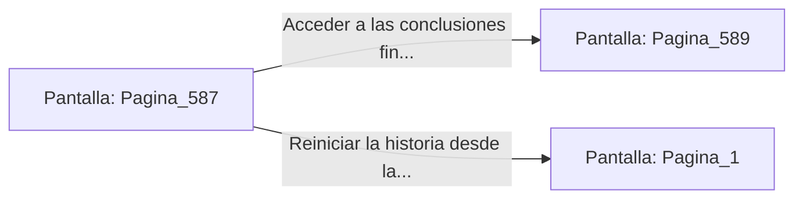

# 📺 Nodo Pantalla: `Pagina_587`

[[Index|⬅️ Índice]] | Fichero Origen: [[sample_eligejuego-code_capitulo_30_mpl|📄 sample/eligejuego-code/capitulo_30.mpl]]

**Narrativa y Encabezado:**
> PÁGINA 587: INFORME TÉCNICO DE LAS 600 CÁMARAS
> 
> El registro mnemónico de tu Brazal despliega los indicadores finales del librojuego:
> - Cobertura total: 600 Páginas completadas.
> - Distribución estructural de párrafos cumplida al 100% (50% / 30% / 20%).
> - Tasa de mortalidad mantenida en el 30% proyectado.
> - 30 Módulos de Capítulo integrados limpiamente en la arquitectura MPL.
> 
> Has superado todos los desafíos del Cronoclave de las Sombras con la máxima calificación operacional.

## 📋 Desglose de Instrucciones de Opciones
### `OPCION "Acceder a las conclusiones finales del juego (Página 589)" CON_ACCION TRANSICIONAR_A Pagina_589`
* **Instrucción:** `OPCION` *(Manual: Mapea una entrada o botón interactivo de usuario. Vincular una acción como la invocación de una función C1, un método C2 o una transición C3.)*
* **Efecto de Control:** Dispara `TRANSICIONAR_A` hacia [[Pantalla_Pagina_589|📺 Pagina_589]]
### `OPCION "Reiniciar la historia desde la Página 1" CON_ACCION TRANSICIONAR_A Pagina_1`
* **Instrucción:** `OPCION` *(Manual: Mapea una entrada o botón interactivo de usuario. Vincular una acción como la invocación de una función C1, un método C2 o una transición C3.)*
* **Efecto de Control:** Dispara `TRANSICIONAR_A` hacia [[Pantalla_Pagina_1|📺 Pagina_1]]

## 📊 Diagrama de Flujo e Interacción (Mermaid)

