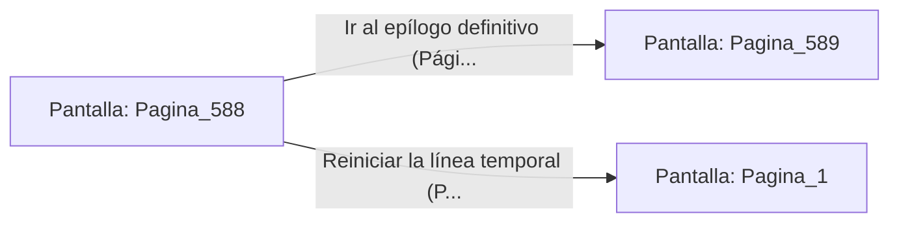

# 📺 Nodo Pantalla: `Pagina_588`

[[Index|⬅️ Índice]] | Fichero Origen: [[sample_eligejuego-code_capitulo_30_mpl|📄 sample/eligejuego-code/capitulo_30.mpl]]

**Narrativa y Encabezado:**
> PÁGINA 588: LA PAZ EN EL IMPERIO CRONO
> 
> Los vientos del abismo han cesado y el aire puro circula libremente por las galerías de granito y bronce.
> 
> La paz ha vuelto a Aethelgard para no extinguirse jamás.

## 📋 Desglose de Instrucciones de Opciones
### `OPCION "Ir al epílogo definitivo (Página 589)" CON_ACCION TRANSICIONAR_A Pagina_589`
* **Instrucción:** `OPCION` *(Manual: Mapea una entrada o botón interactivo de usuario. Vincular una acción como la invocación de una función C1, un método C2 o una transición C3.)*
* **Efecto de Control:** Dispara `TRANSICIONAR_A` hacia [[Pantalla_Pagina_589|📺 Pagina_589]]
### `OPCION "Reiniciar la línea temporal (Página 1)" CON_ACCION TRANSICIONAR_A Pagina_1`
* **Instrucción:** `OPCION` *(Manual: Mapea una entrada o botón interactivo de usuario. Vincular una acción como la invocación de una función C1, un método C2 o una transición C3.)*
* **Efecto de Control:** Dispara `TRANSICIONAR_A` hacia [[Pantalla_Pagina_1|📺 Pagina_1]]

## 📊 Diagrama de Flujo e Interacción (Mermaid)

