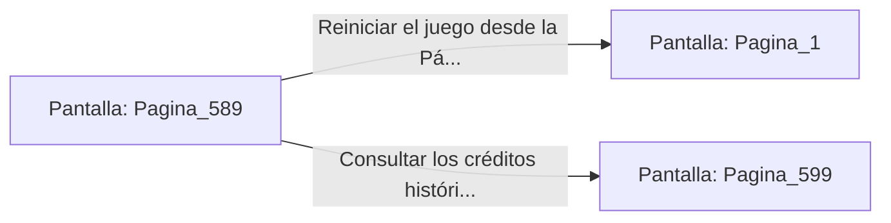

# 📺 Nodo Pantalla: `Pagina_589`

[[Index|⬅️ Índice]] | Fichero Origen: [[sample_eligejuego-code_capitulo_30_mpl|📄 sample/eligejuego-code/capitulo_30.mpl]]

**Narrativa y Encabezado:**
> PÁGINA 589: EPÍLOGO DEFINITIVO
> 
> Has completado 'El Cronoclave de las Sombras', el librojuego interactivo en lenguaje MPL de 600 páginas divididas en 30 capítulos.
> 
> Tu travesía a través de los pasillos, laboratorios, forjas y santuarios de Aethelgard pasará a la historia como un modelo de astucia, valor y perseverancia.
> 
> ¡Enhorabuena por haber alcanzado la victoria absoluta y haber salvado la realidad!

## 📋 Desglose de Instrucciones de Opciones
### `OPCION "Reiniciar el juego desde la Página 1" CON_ACCION TRANSICIONAR_A Pagina_1`
* **Instrucción:** `OPCION` *(Manual: Mapea una entrada o botón interactivo de usuario. Vincular una acción como la invocación de una función C1, un método C2 o una transición C3.)*
* **Efecto de Control:** Dispara `TRANSICIONAR_A` hacia [[Pantalla_Pagina_1|📺 Pagina_1]]
### `OPCION "Consultar los créditos históricos finales (Página 599)" CON_ACCION TRANSICIONAR_A Pagina_599`
* **Instrucción:** `OPCION` *(Manual: Mapea una entrada o botón interactivo de usuario. Vincular una acción como la invocación de una función C1, un método C2 o una transición C3.)*
* **Efecto de Control:** Dispara `TRANSICIONAR_A` hacia [[Pantalla_Pagina_599|📺 Pagina_599]]

## 📊 Diagrama de Flujo e Interacción (Mermaid)

