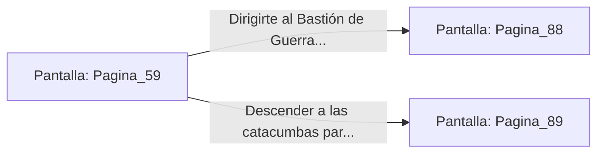

# 📺 Nodo Pantalla: `Pagina_59`

[[Index|⬅️ Índice]] | Fichero Origen: [[sample_eligejuego-code_capitulo_04_mpl|📄 sample/eligejuego-code/capitulo_04.mpl]]

**Narrativa y Encabezado:**
> PÁGINA 59: LA ARMERÍA DE LOS REYES
> 
> Tu marca genética activa los sellos de sangre de la armería secreta. Dos puertas de titanio se abren de par en par, revelando un estoque de fase de luz y un escudo de refracción cuántica.
> 
> Equipas ambas reliquias en tu indumentaria militar, sintiéndote preparado para afrontar a los sirvientes más poderosos del Inquisidor.

## 📋 Desglose de Instrucciones de Opciones
### `OPCION "Dirigirte al Bastión de Guerra equipado con las reliquias de rey" CON_ACCION TRANSICIONAR_A Pagina_88`
* **Instrucción:** `OPCION` *(Manual: Mapea una entrada o botón interactivo de usuario. Vincular una acción como la invocación de una función C1, un método C2 o una transición C3.)*
* **Efecto de Control:** Dispara `TRANSICIONAR_A` hacia [[Pantalla_Pagina_88|📺 Pagina_88]]
### `OPCION "Descender a las catacumbas para probar tu nuevo armamento" CON_ACCION TRANSICIONAR_A Pagina_89`
* **Instrucción:** `OPCION` *(Manual: Mapea una entrada o botón interactivo de usuario. Vincular una acción como la invocación de una función C1, un método C2 o una transición C3.)*
* **Efecto de Control:** Dispara `TRANSICIONAR_A` hacia [[Pantalla_Pagina_89|📺 Pagina_89]]

## 📊 Diagrama de Flujo e Interacción (Mermaid)

