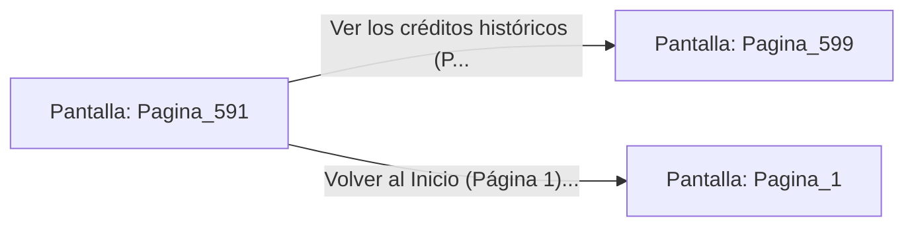

# 📺 Nodo Pantalla: `Pagina_591`

[[Index|⬅️ Índice]] | Fichero Origen: [[sample_eligejuego-code_capitulo_30_mpl|📄 sample/eligejuego-code/capitulo_30.mpl]]

**Narrativa y Encabezado:**
> PÁGINA 591: LA MEMORIA DEL NÚCLEO
> 
> Las consolas del Gran Núcleo Maestro guardan en su matriz cuántica la secuencia exacta de tus 600 decisiones a lo largo del viaje.
> 
> Cada victoria contra las trampas y autómatas de Malakor queda inmortalizada en el cristal de cuarzo del altar principal.
> 
> Los sabios del futuro estudiarán tu estrategia para mantener la estabilidad de las líneas temporales.

## 📋 Desglose de Instrucciones de Opciones
### `OPCION "Ver los créditos históricos (Página 599)" CON_ACCION TRANSICIONAR_A Pagina_599`
* **Instrucción:** `OPCION` *(Manual: Mapea una entrada o botón interactivo de usuario. Vincular una acción como la invocación de una función C1, un método C2 o una transición C3.)*
* **Efecto de Control:** Dispara `TRANSICIONAR_A` hacia [[Pantalla_Pagina_599|📺 Pagina_599]]
### `OPCION "Volver al Inicio (Página 1)" CON_ACCION TRANSICIONAR_A Pagina_1`
* **Instrucción:** `OPCION` *(Manual: Mapea una entrada o botón interactivo de usuario. Vincular una acción como la invocación de una función C1, un método C2 o una transición C3.)*
* **Efecto de Control:** Dispara `TRANSICIONAR_A` hacia [[Pantalla_Pagina_1|📺 Pagina_1]]

## 📊 Diagrama de Flujo e Interacción (Mermaid)

