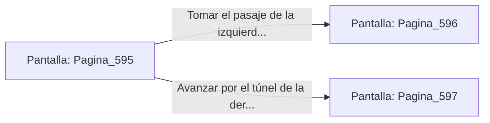

# 📺 Nodo Pantalla: `Pagina_595`

[[Index|⬅️ Índice]] | Fichero Origen: [[sample_eligejuego-code_capitulo_10_trono_oscarpu_mpl|📄 sample/eligejuego-code/capitulo_10_trono_oscarpu.mpl]]

**Narrativa y Encabezado:**
> Página 595: El Gran Trono de Oscarpu
> 
> El gran trono de obsidiana del Rey Nigromante Oscarpu domina el salón rodeado por un ejército de espectros. Te encuentras ante una encrucijada en la penumbra de la mazmorra. Debes tomar una decisión.

## 📋 Desglose de Instrucciones de Opciones
### `OPCION "Tomar el pasaje de la izquierda (Página 596)" CON_ACCION TRANSICIONAR_A Pagina_596`
* **Instrucción:** `OPCION` *(Manual: Mapea una entrada o botón interactivo de usuario. Vincular una acción como la invocación de una función C1, un método C2 o una transición C3.)*
* **Efecto de Control:** Dispara `TRANSICIONAR_A` hacia [[Pantalla_Pagina_596|📺 Pagina_596]]
### `OPCION "Avanzar por el túnel de la derecha (Página 597)" CON_ACCION TRANSICIONAR_A Pagina_597`
* **Instrucción:** `OPCION` *(Manual: Mapea una entrada o botón interactivo de usuario. Vincular una acción como la invocación de una función C1, un método C2 o una transición C3.)*
* **Efecto de Control:** Dispara `TRANSICIONAR_A` hacia [[Pantalla_Pagina_597|📺 Pagina_597]]

## 📊 Diagrama de Flujo e Interacción (Mermaid)

