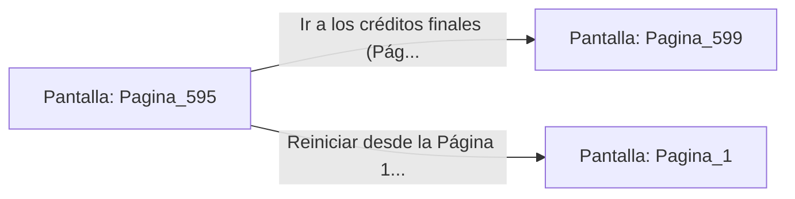

# 📺 Nodo Pantalla: `Pagina_595`

[[Index|⬅️ Índice]] | Fichero Origen: [[sample_eligejuego-code_capitulo_30_mpl|📄 sample/eligejuego-code/capitulo_30.mpl]]

**Narrativa y Encabezado:**
> PÁGINA 595: EL RETORNO DEL HÉROE
> 
> Te encaminas a la salida del complejo mientras las compuertas de seguridad se abren a tu paso rindiendo honores.
> 
> El Brazal de Convergencia se apaga suavemente, habiendo completado su propósito supremo.
> 
> Eres libre de explorar el nuevo mundo restaurado de Aethelgard.

## 📋 Desglose de Instrucciones de Opciones
### `OPCION "Ir a los créditos finales (Página 599)" CON_ACCION TRANSICIONAR_A Pagina_599`
* **Instrucción:** `OPCION` *(Manual: Mapea una entrada o botón interactivo de usuario. Vincular una acción como la invocación de una función C1, un método C2 o una transición C3.)*
* **Efecto de Control:** Dispara `TRANSICIONAR_A` hacia [[Pantalla_Pagina_599|📺 Pagina_599]]
### `OPCION "Reiniciar desde la Página 1" CON_ACCION TRANSICIONAR_A Pagina_1`
* **Instrucción:** `OPCION` *(Manual: Mapea una entrada o botón interactivo de usuario. Vincular una acción como la invocación de una función C1, un método C2 o una transición C3.)*
* **Efecto de Control:** Dispara `TRANSICIONAR_A` hacia [[Pantalla_Pagina_1|📺 Pagina_1]]

## 📊 Diagrama de Flujo e Interacción (Mermaid)

