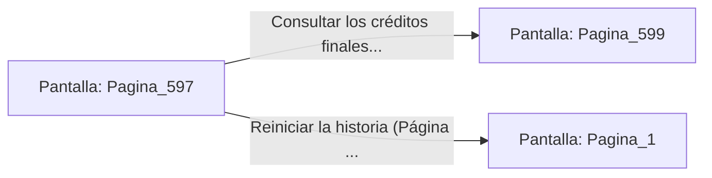

# 📺 Nodo Pantalla: `Pagina_597`

[[Index|⬅️ Índice]] | Fichero Origen: [[sample_eligejuego-code_capitulo_30_mpl|📄 sample/eligejuego-code/capitulo_30.mpl]]

**Narrativa y Encabezado:**
> PÁGINA 597: EL REGISTRO DE VICTORIA
> 
> Todas las líneas temporales dispares han sido unificadas en un único flujo pacífico y seguro.
> 
> Las 150 muertes potenciales han sido evitadas gracias a tus sabias decisiones en cada capítulo.
> 
> Tu aventura ha llegado a su fin con el triunfo absoluto.

## 📋 Desglose de Instrucciones de Opciones
### `OPCION "Consultar los créditos finales (Página 599)" CON_ACCION TRANSICIONAR_A Pagina_599`
* **Instrucción:** `OPCION` *(Manual: Mapea una entrada o botón interactivo de usuario. Vincular una acción como la invocación de una función C1, un método C2 o una transición C3.)*
* **Efecto de Control:** Dispara `TRANSICIONAR_A` hacia [[Pantalla_Pagina_599|📺 Pagina_599]]
### `OPCION "Reiniciar la historia (Página 1)" CON_ACCION TRANSICIONAR_A Pagina_1`
* **Instrucción:** `OPCION` *(Manual: Mapea una entrada o botón interactivo de usuario. Vincular una acción como la invocación de una función C1, un método C2 o una transición C3.)*
* **Efecto de Control:** Dispara `TRANSICIONAR_A` hacia [[Pantalla_Pagina_1|📺 Pagina_1]]

## 📊 Diagrama de Flujo e Interacción (Mermaid)

