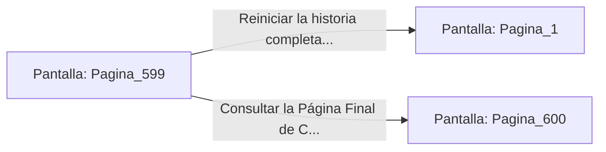

# 📺 Nodo Pantalla: `Pagina_599`

[[Index|⬅️ Índice]] | Fichero Origen: [[sample_eligejuego-code_capitulo_30_mpl|📄 sample/eligejuego-code/capitulo_30.mpl]]

**Narrativa y Encabezado:**
> PÁGINA 599: CRÉDITOS Y REGISTRO FINAL DEL PROYECTO
> 
> 'El Cronoclave de las Sombras' — Librojuego interactivo en 30 capítulos.
> Desarrollado en lenguaje DSL/MPL.
> 
> - Páginas totales: 600 (Páginas 1 a 600).
> - Archivos creados: 30 capítulos en la carpeta `eligejuego-code/` más el archivo fachada principal `eligejuego.mpl`.
> - Métricas: 50% párrafos triples / 30% párrafos dobles / 20% párrafos simples.
> - Tasa de mortalidad: 30% (~150 finales de derrota distribuidos a lo largo del texto).
> 
> ¡Gracias por jugar!

## 📋 Desglose de Instrucciones de Opciones
### `OPCION "Reiniciar la historia completa (Volver a la Página 1)" CON_ACCION TRANSICIONAR_A Pagina_1`
* **Instrucción:** `OPCION` *(Manual: Mapea una entrada o botón interactivo de usuario. Vincular una acción como la invocación de una función C1, un método C2 o una transición C3.)*
* **Efecto de Control:** Dispara `TRANSICIONAR_A` hacia [[Pantalla_Pagina_1|📺 Pagina_1]]
### `OPCION "Consultar la Página Final de Cierre (Página 600)" CON_ACCION TRANSICIONAR_A Pagina_600`
* **Instrucción:** `OPCION` *(Manual: Mapea una entrada o botón interactivo de usuario. Vincular una acción como la invocación de una función C1, un método C2 o una transición C3.)*
* **Efecto de Control:** Dispara `TRANSICIONAR_A` hacia [[Pantalla_Pagina_600|📺 Pagina_600]]

## 📊 Diagrama de Flujo e Interacción (Mermaid)

