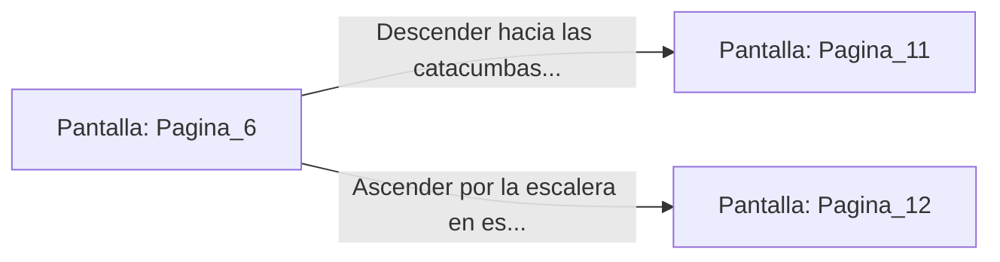

# 📺 Nodo Pantalla: `Pagina_6`

[[Index|⬅️ Índice]] | Fichero Origen: [[sample_eligejuego-code_capitulo_01_mpl|📄 sample/eligejuego-code/capitulo_01.mpl]]

**Narrativa y Encabezado:**
> PÁGINA 6: LA SANTUARIO DEL ESCARABAJO
> 
> Empujas la pesada hoja de bronce, que cede emitiendo un chirrido metálico. Al cruzar el umbral, te encuentras en un santuario circular custodiado por estatuas gigantescas de guardianes alados. En el centro de la sala, sobre un pedestal de obsidiana, descansa una esfera cristalina que flota en el aire matizada por destellos dorados.
> 
> Al acercarte, el Brazal de Convergencia reacciona, absorbiendo parte de la energía radiante del orbe. Sientes cómo la vitalidad regresa a tus músculos y tu mente aclara parte de las brumas de la amnesia. Has encontrado un Fragmento del Núcleo de Éter.
> 
> Al fondo de la sala se abren dos arcos de piedra: uno conduce a las catacumbas sumergidas y el otro asciende en espiral hacia las galerías de los Autómatas.

## 📋 Desglose de Instrucciones de Opciones
### `OPCION "Descender hacia las catacumbas sumergidas" CON_ACCION TRANSICIONAR_A Pagina_11`
* **Instrucción:** `OPCION` *(Manual: Mapea una entrada o botón interactivo de usuario. Vincular una acción como la invocación de una función C1, un método C2 o una transición C3.)*
* **Efecto de Control:** Dispara `TRANSICIONAR_A` hacia [[Pantalla_Pagina_11|📺 Pagina_11]]
### `OPCION "Ascender por la escalera en espiral hacia la Galería de los Autómatas" CON_ACCION TRANSICIONAR_A Pagina_12`
* **Instrucción:** `OPCION` *(Manual: Mapea una entrada o botón interactivo de usuario. Vincular una acción como la invocación de una función C1, un método C2 o una transición C3.)*
* **Efecto de Control:** Dispara `TRANSICIONAR_A` hacia [[Pantalla_Pagina_12|📺 Pagina_12]]

## 📊 Diagrama de Flujo e Interacción (Mermaid)

