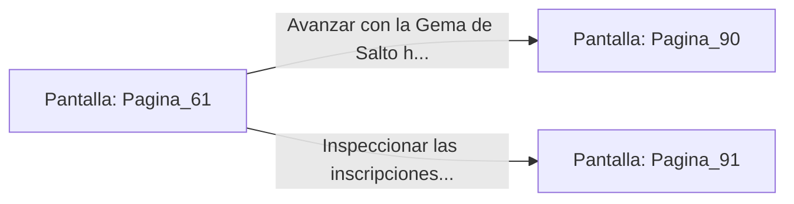

# 📺 Nodo Pantalla: `Pagina_61`

[[Index|⬅️ Índice]] | Fichero Origen: [[sample_eligejuego-code_capitulo_04_mpl|📄 sample/eligejuego-code/capitulo_04.mpl]]

**Narrativa y Encabezado:**
> PÁGINA 61: LA ESCOTILLA OCULTA
> 
> Te impulsas con fuerza y logras sujetarte al borde de la repisa secreta. Con un esfuerzo agónico de brazos, te encaramas a la cornisa y abres la pequeña escotilla metálica, colándote al interior antes de que la plataforma del foso ceda definitivamente.
> 
> Te encuentras en una estrecha galería de servicio iluminada por cristales arcanos. Al final del pasillo descansa un cofre de los Antiguos Talladores que contiene una Gema de Salto Temporal.
> 
> Tras guardar la reliquia en tu inventario, sigues la única salida disponible hacia el Nivel de los Calderos.

## 📋 Desglose de Instrucciones de Opciones
### `OPCION "Avanzar con la Gema de Salto hacia el Nivel de los Calderos" CON_ACCION TRANSICIONAR_A Pagina_90`
* **Instrucción:** `OPCION` *(Manual: Mapea una entrada o botón interactivo de usuario. Vincular una acción como la invocación de una función C1, un método C2 o una transición C3.)*
* **Efecto de Control:** Dispara `TRANSICIONAR_A` hacia [[Pantalla_Pagina_90|📺 Pagina_90]]
### `OPCION "Inspeccionar las inscripciones de las paredes de la galería" CON_ACCION TRANSICIONAR_A Pagina_91`
* **Instrucción:** `OPCION` *(Manual: Mapea una entrada o botón interactivo de usuario. Vincular una acción como la invocación de una función C1, un método C2 o una transición C3.)*
* **Efecto de Control:** Dispara `TRANSICIONAR_A` hacia [[Pantalla_Pagina_91|📺 Pagina_91]]

## 📊 Diagrama de Flujo e Interacción (Mermaid)

