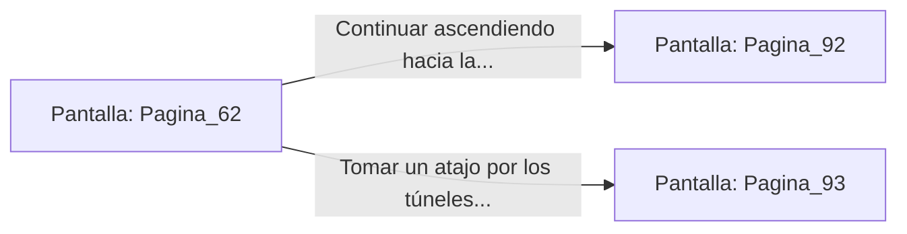

# 📺 Nodo Pantalla: `Pagina_62`

[[Index|⬅️ Índice]] | Fichero Origen: [[sample_eligejuego-code_capitulo_04_mpl|📄 sample/eligejuego-code/capitulo_04.mpl]]

**Narrativa y Encabezado:**
> PÁGINA 62: EL PASILLO PRINCIPAL DEL FOSO
> 
> Esperas pacientemente a que los oscilamientos de la plataforma disminuyan y saltas con precisión sobre el suelo firme del pasillo principal.
> 
> Desde aquí, el camino asciende suavemente en abanico hacia las forjas de armamento pesado de la ciudadela.

## 📋 Desglose de Instrucciones de Opciones
### `OPCION "Continuar ascendiendo hacia las Forjas Pesadas" CON_ACCION TRANSICIONAR_A Pagina_92`
* **Instrucción:** `OPCION` *(Manual: Mapea una entrada o botón interactivo de usuario. Vincular una acción como la invocación de una función C1, un método C2 o una transición C3.)*
* **Efecto de Control:** Dispara `TRANSICIONAR_A` hacia [[Pantalla_Pagina_92|📺 Pagina_92]]
### `OPCION "Tomar un atajo por los túneles de ventilación laterales" CON_ACCION TRANSICIONAR_A Pagina_93`
* **Instrucción:** `OPCION` *(Manual: Mapea una entrada o botón interactivo de usuario. Vincular una acción como la invocación de una función C1, un método C2 o una transición C3.)*
* **Efecto de Control:** Dispara `TRANSICIONAR_A` hacia [[Pantalla_Pagina_93|📺 Pagina_93]]

## 📊 Diagrama de Flujo e Interacción (Mermaid)

