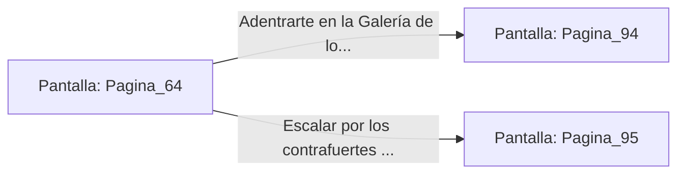

# 📺 Nodo Pantalla: `Pagina_64`

[[Index|⬅️ Índice]] | Fichero Origen: [[sample_eligejuego-code_capitulo_04_mpl|📄 sample/eligejuego-code/capitulo_04.mpl]]

**Narrativa y Encabezado:**
> PÁGINA 64: EL PASADIZO CUBIERTO
> 
> Avanzas sigilosamente tras la sombra de los pilares de mármol del pasadizo cubierto. El murmullo de los cultistas ritualistas actúa como una cortina de sonido que enmascara por completo tus pisadas.
> 
> Alcanzas la salida opuesta del Claustro sin haber llamado la atención de los Observadores. Frente a ti se abre la Galería de los Espejos de Fase, cuyo reflejo distorsiona las dimensiones del espacio.
> 
> Debes decidir si atravesar la Galería de los Espejos o subir por los contrafuertes hacia los tejados del Palacio.

## 📋 Desglose de Instrucciones de Opciones
### `OPCION "Adentrarte en la Galería de los Espejos de Fase" CON_ACCION TRANSICIONAR_A Pagina_94`
* **Instrucción:** `OPCION` *(Manual: Mapea una entrada o botón interactivo de usuario. Vincular una acción como la invocación de una función C1, un método C2 o una transición C3.)*
* **Efecto de Control:** Dispara `TRANSICIONAR_A` hacia [[Pantalla_Pagina_94|📺 Pagina_94]]
### `OPCION "Escalar por los contrafuertes de mármol hacia los Tejados" CON_ACCION TRANSICIONAR_A Pagina_95`
* **Instrucción:** `OPCION` *(Manual: Mapea una entrada o botón interactivo de usuario. Vincular una acción como la invocación de una función C1, un método C2 o una transición C3.)*
* **Efecto de Control:** Dispara `TRANSICIONAR_A` hacia [[Pantalla_Pagina_95|📺 Pagina_95]]

## 📊 Diagrama de Flujo e Interacción (Mermaid)

