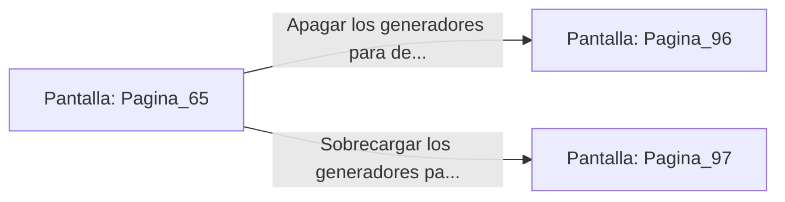

# 📺 Nodo Pantalla: `Pagina_65`

[[Index|⬅️ Índice]] | Fichero Origen: [[sample_eligejuego-code_capitulo_04_mpl|📄 sample/eligejuego-code/capitulo_04.mpl]]

**Narrativa y Encabezado:**
> PÁGINA 65: LOS GENERADORES ARCANOS
> 
> Bajas por la pendiente rúnica hasta llegar a la cámara de los Generadores Arcanos. Tres inmensos anillos de bronce giran en torno a una columna de fuego azul, produciendo la energía que alimenta toda la red defensiva.
> 
> Sobre una mesa de trabajo descubres los esquemas de derivación eléctrica que permiten apagar los escudos del Bastión Central.

## 📋 Desglose de Instrucciones de Opciones
### `OPCION "Apagar los generadores para desactivar los escudos del Bastión" CON_ACCION TRANSICIONAR_A Pagina_96`
* **Instrucción:** `OPCION` *(Manual: Mapea una entrada o botón interactivo de usuario. Vincular una acción como la invocación de una función C1, un método C2 o una transición C3.)*
* **Efecto de Control:** Dispara `TRANSICIONAR_A` hacia [[Pantalla_Pagina_96|📺 Pagina_96]]
### `OPCION "Sobrecargar los generadores para provocar un apagón masivo" CON_ACCION TRANSICIONAR_A Pagina_97`
* **Instrucción:** `OPCION` *(Manual: Mapea una entrada o botón interactivo de usuario. Vincular una acción como la invocación de una función C1, un método C2 o una transición C3.)*
* **Efecto de Control:** Dispara `TRANSICIONAR_A` hacia [[Pantalla_Pagina_97|📺 Pagina_97]]

## 📊 Diagrama de Flujo e Interacción (Mermaid)

