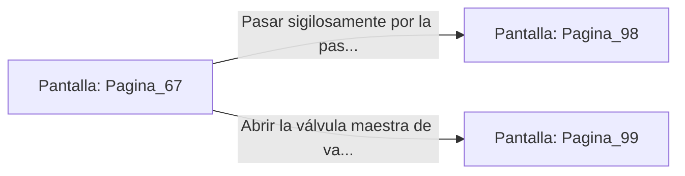

# 📺 Nodo Pantalla: `Pagina_67`

[[Index|⬅️ Índice]] | Fichero Origen: [[sample_eligejuego-code_capitulo_04_mpl|📄 sample/eligejuego-code/capitulo_04.mpl]]

**Narrativa y Encabezado:**
> PÁGINA 67: LA SALA DE CALDERAS
> 
> Penetras en la sofocante Sala de Calderas del Sector Cero. Enormes tanques de combustión de carbón alquímico rugen con fuerza, impulsando los sistemas hidráulicos de las puertas principales de la ciudadela.
> 
> Un grupo de ingenieros mecánicos trabaja de espaldas a ti ajustando los niveles de presión. Entre el ruido de los pistones y los chorros de vapor, podrías pasar desapercibido hacia la pasarela superior.
> 
> Asimismo, ves la oportunidad de manipular la válvula maestra de vapor para cegar a los ingenieros y asegurar tu avance.

## 📋 Desglose de Instrucciones de Opciones
### `OPCION "Pasar sigilosamente por la pasarela superior" CON_ACCION TRANSICIONAR_A Pagina_98`
* **Instrucción:** `OPCION` *(Manual: Mapea una entrada o botón interactivo de usuario. Vincular una acción como la invocación de una función C1, un método C2 o una transición C3.)*
* **Efecto de Control:** Dispara `TRANSICIONAR_A` hacia [[Pantalla_Pagina_98|📺 Pagina_98]]
### `OPCION "Abrir la válvula maestra de vapor para cegar a los ingenieros" CON_ACCION TRANSICIONAR_A Pagina_99`
* **Instrucción:** `OPCION` *(Manual: Mapea una entrada o botón interactivo de usuario. Vincular una acción como la invocación de una función C1, un método C2 o una transición C3.)*
* **Efecto de Control:** Dispara `TRANSICIONAR_A` hacia [[Pantalla_Pagina_99|📺 Pagina_99]]

## 📊 Diagrama de Flujo e Interacción (Mermaid)

