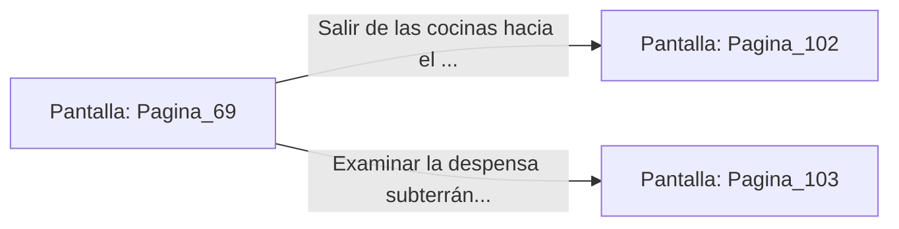

# 📺 Nodo Pantalla: `Pagina_69`

[[Index|⬅️ Índice]] | Fichero Origen: [[sample_eligejuego-code_capitulo_04_mpl|📄 sample/eligejuego-code/capitulo_04.mpl]]

**Narrativa y Encabezado:**
> PÁGINA 69: LAS COCINAS DEL PALACIO
> 
> Subes por la escalera lateral y accedes a las amplias cocinas abandonadas. Las ollas de cobre y los calderos de bronce yacen esparcidos, pero encuentras raciones imperecederas que reponen parte de tu resistencia.

## 📋 Desglose de Instrucciones de Opciones
### `OPCION "Salir de las cocinas hacia el Gran Comedor" CON_ACCION TRANSICIONAR_A Pagina_102`
* **Instrucción:** `OPCION` *(Manual: Mapea una entrada o botón interactivo de usuario. Vincular una acción como la invocación de una función C1, un método C2 o una transición C3.)*
* **Efecto de Control:** Dispara `TRANSICIONAR_A` hacia [[Pantalla_Pagina_102|📺 Pagina_102]]
### `OPCION "Examinar la despensa subterránea" CON_ACCION TRANSICIONAR_A Pagina_103`
* **Instrucción:** `OPCION` *(Manual: Mapea una entrada o botón interactivo de usuario. Vincular una acción como la invocación de una función C1, un método C2 o una transición C3.)*
* **Efecto de Control:** Dispara `TRANSICIONAR_A` hacia [[Pantalla_Pagina_103|📺 Pagina_103]]

## 📊 Diagrama de Flujo e Interacción (Mermaid)

