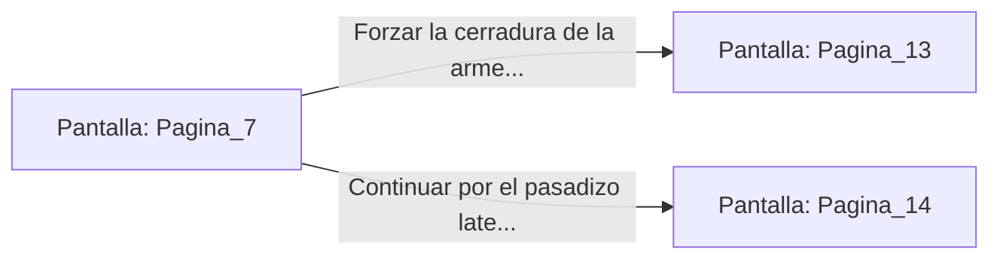

# 📺 Nodo Pantalla: `Pagina_7`

[[Index|⬅️ Índice]] | Fichero Origen: [[sample_eligejuego-code_capitulo_01_mpl|📄 sample/eligejuego-code/capitulo_01.mpl]]

**Narrativa y Encabezado:**
> PÁGINA 7: EL PASO CALCULADO
> 
> Midiendo cada uno de tus movimientos, sorteas las losas trampa con destreza gimnástica hasta alcanzar el extremo opuesto del pasillo sano y salvo, donde una verja de hierro forjado protege la armería del santuario.

## 📋 Desglose de Instrucciones de Opciones
### `OPCION "Forzar la cerradura de la armería" CON_ACCION TRANSICIONAR_A Pagina_13`
* **Instrucción:** `OPCION` *(Manual: Mapea una entrada o botón interactivo de usuario. Vincular una acción como la invocación de una función C1, un método C2 o una transición C3.)*
* **Efecto de Control:** Dispara `TRANSICIONAR_A` hacia [[Pantalla_Pagina_13|📺 Pagina_13]]
### `OPCION "Continuar por el pasadizo lateral hacia los hornos de alquimia" CON_ACCION TRANSICIONAR_A Pagina_14`
* **Instrucción:** `OPCION` *(Manual: Mapea una entrada o botón interactivo de usuario. Vincular una acción como la invocación de una función C1, un método C2 o una transición C3.)*
* **Efecto de Control:** Dispara `TRANSICIONAR_A` hacia [[Pantalla_Pagina_14|📺 Pagina_14]]

## 📊 Diagrama de Flujo e Interacción (Mermaid)

