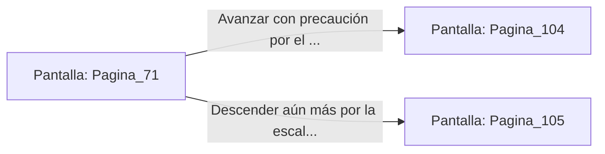

# 📺 Nodo Pantalla: `Pagina_71`

[[Index|⬅️ Índice]] | Fichero Origen: [[sample_eligejuego-code_capitulo_05_mpl|📄 sample/eligejuego-code/capitulo_05.mpl]]

**Narrativa y Encabezado:**
> PÁGINA 71: EL ASCENSOR EXPRÉS
> 
> Abordas la plataforma metálica del ascensor exprés y activas la palanca magnética. La cabina desciende a velocidad vertiginosa por un pozo vertical iluminado por anillos de luz azulina que parpadean rítmicamente a tu paso.
> 
> Durante el descenso, el sistema de diagnóstico del Brazal de Convergencia detecta un incremento drástico en la radiación de Éter conforme te aproximas a los niveles inferiores. Los mapas de la ciudadela confirman que te diriges directamente a la Fosa de los Juramentos.
> 
> El elevador frena bruscamente en el Nivel Subterráneo Nueve, abriendo sus puertas hacia un pasillo custodiado por trampas de presión o una escalinata de caracol.

## 📋 Desglose de Instrucciones de Opciones
### `OPCION "Avanzar con precaución por el pasillo de las trampas de presión" CON_ACCION TRANSICIONAR_A Pagina_104`
* **Instrucción:** `OPCION` *(Manual: Mapea una entrada o botón interactivo de usuario. Vincular una acción como la invocación de una función C1, un método C2 o una transición C3.)*
* **Efecto de Control:** Dispara `TRANSICIONAR_A` hacia [[Pantalla_Pagina_104|📺 Pagina_104]]
### `OPCION "Descender aún más por la escalinata de caracol de la izquierda" CON_ACCION TRANSICIONAR_A Pagina_105`
* **Instrucción:** `OPCION` *(Manual: Mapea una entrada o botón interactivo de usuario. Vincular una acción como la invocación de una función C1, un método C2 o una transición C3.)*
* **Efecto de Control:** Dispara `TRANSICIONAR_A` hacia [[Pantalla_Pagina_105|📺 Pagina_105]]

## 📊 Diagrama de Flujo e Interacción (Mermaid)

