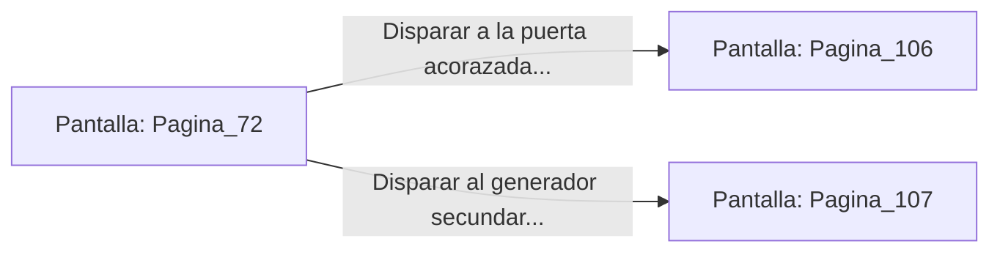

# 📺 Nodo Pantalla: `Pagina_72`

[[Index|⬅️ Índice]] | Fichero Origen: [[sample_eligejuego-code_capitulo_05_mpl|📄 sample/eligejuego-code/capitulo_05.mpl]]

**Narrativa y Encabezado:**
> PÁGINA 72: EL CAÑÓN DE RIEL
> 
> Te aproximas al cañón de riel fijo en el puesto de control. La pantalla de puntería aún permanece encendida, mostrando varios escuadrones de autómata patrullando el puente principal de la muralla exterior.
> 
> Puedes usar el cañón para destruir la puerta acorazada del puente y despejar el acceso o disparar contra el generador secundario para cortar la electricidad del sector.

## 📋 Desglose de Instrucciones de Opciones
### `OPCION "Disparar a la puerta acorazada para abrir paso hacia el puente" CON_ACCION TRANSICIONAR_A Pagina_106`
* **Instrucción:** `OPCION` *(Manual: Mapea una entrada o botón interactivo de usuario. Vincular una acción como la invocación de una función C1, un método C2 o una transición C3.)*
* **Efecto de Control:** Dispara `TRANSICIONAR_A` hacia [[Pantalla_Pagina_106|📺 Pagina_106]]
### `OPCION "Disparar al generador secundario para provocar un apagón local" CON_ACCION TRANSICIONAR_A Pagina_107`
* **Instrucción:** `OPCION` *(Manual: Mapea una entrada o botón interactivo de usuario. Vincular una acción como la invocación de una función C1, un método C2 o una transición C3.)*
* **Efecto de Control:** Dispara `TRANSICIONAR_A` hacia [[Pantalla_Pagina_107|📺 Pagina_107]]

## 📊 Diagrama de Flujo e Interacción (Mermaid)

