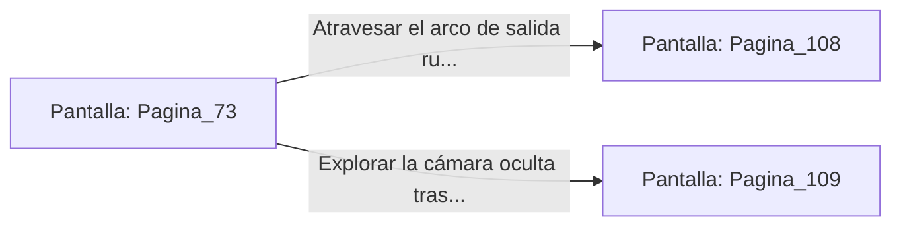

# 📺 Nodo Pantalla: `Pagina_73`

[[Index|⬅️ Índice]] | Fichero Origen: [[sample_eligejuego-code_capitulo_05_mpl|📄 sample/eligejuego-code/capitulo_05.mpl]]

**Narrativa y Encabezado:**
> PÁGINA 73: LA SAVIA DE LA FLOR REINA
> 
> Extiendes la mano con pulso firme hacia el cáliz de la flor reina de Éter, evitando rozar las espinas térmicas. Con extrema delicadeza, usas una jeringa de extracción de tu Brazal para absorber la savia bioluminiscente que gotea de sus pétalos.
> 
> Las avispas biomecánicas zumban en torno a tu cabeza, pero la ausencia de movimientos bruscos evita que activen su protocolo de enjambre. La savia destilada restaura por completo tus reservas de maná y potencia tu velocidad de reacción.
> 
> Guardas el extracto purificado en tu inventario antes de atravesar el arco de salida del invernadero hacia los Bastiones de Guerra.

## 📋 Desglose de Instrucciones de Opciones
### `OPCION "Atravesar el arco de salida rumbo a los Bastiones de Guerra" CON_ACCION TRANSICIONAR_A Pagina_108`
* **Instrucción:** `OPCION` *(Manual: Mapea una entrada o botón interactivo de usuario. Vincular una acción como la invocación de una función C1, un método C2 o una transición C3.)*
* **Efecto de Control:** Dispara `TRANSICIONAR_A` hacia [[Pantalla_Pagina_108|📺 Pagina_108]]
### `OPCION "Explorar la cámara oculta tras las raíces gigantescas" CON_ACCION TRANSICIONAR_A Pagina_109`
* **Instrucción:** `OPCION` *(Manual: Mapea una entrada o botón interactivo de usuario. Vincular una acción como la invocación de una función C1, un método C2 o una transición C3.)*
* **Efecto de Control:** Dispara `TRANSICIONAR_A` hacia [[Pantalla_Pagina_109|📺 Pagina_109]]

## 📊 Diagrama de Flujo e Interacción (Mermaid)

