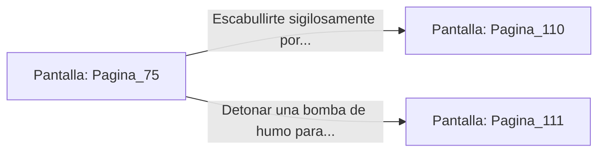

# 📺 Nodo Pantalla: `Pagina_75`

[[Index|⬅️ Índice]] | Fichero Origen: [[sample_eligejuego-code_capitulo_05_mpl|📄 sample/eligejuego-code/capitulo_05.mpl]]

**Narrativa y Encabezado:**
> PÁGINA 75: EL CARRO DE SUMINISTROS
> 
> Te oculta hábilmente bajo una lona reforzada entre las cajas de munición del carro de suministros. Un momento después, los sirvientes mecánicos enganchan la unidad y la arrastran al interior de la fortaleza cruzando las pesadas puertas de bronce.
> 
> Escuchas el chirrido de los cerrojos al cerrarse tras el vehículo. A través de una pequeña hendidura en la lona, observas que el carro se detiene en el patio de armas del Bastión Central, rodeado de guardias de élite.
> 
> Tienes la oportunidad de salir sigilosamente por la parte trasera mientras descargan la parte delantera o activar una pequeña carga de humo para cubrir tu huida.

## 📋 Desglose de Instrucciones de Opciones
### `OPCION "Escabullirte sigilosamente por la parte trasera del carro" CON_ACCION TRANSICIONAR_A Pagina_110`
* **Instrucción:** `OPCION` *(Manual: Mapea una entrada o botón interactivo de usuario. Vincular una acción como la invocación de una función C1, un método C2 o una transición C3.)*
* **Efecto de Control:** Dispara `TRANSICIONAR_A` hacia [[Pantalla_Pagina_110|📺 Pagina_110]]
### `OPCION "Detonar una bomba de humo para cubrir tu escape al patio" CON_ACCION TRANSICIONAR_A Pagina_111`
* **Instrucción:** `OPCION` *(Manual: Mapea una entrada o botón interactivo de usuario. Vincular una acción como la invocación de una función C1, un método C2 o una transición C3.)*
* **Efecto de Control:** Dispara `TRANSICIONAR_A` hacia [[Pantalla_Pagina_111|📺 Pagina_111]]

## 📊 Diagrama de Flujo e Interacción (Mermaid)

