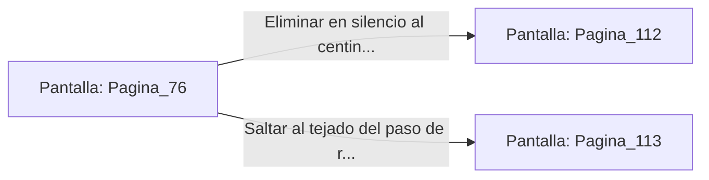

# 📺 Nodo Pantalla: `Pagina_76`

[[Index|⬅️ Índice]] | Fichero Origen: [[sample_eligejuego-code_capitulo_05_mpl|📄 sample/eligejuego-code/capitulo_05.mpl]]

**Narrativa y Encabezado:**
> PÁGINA 76: LA ESCALADA DEL MURO
> 
> Disparas tu gancho de agarre hacia los matacanes de la muralla de granito. El ancla de titanio se fija con firmeza y comienzas a ascender rápidamente usando los apoyos de la mampostería.
> 
> Alcanzas la cima de la almena justo cuando la patrulla de la guardia nocturna pasa a escasos metros de tu posición.

## 📋 Desglose de Instrucciones de Opciones
### `OPCION "Eliminar en silencio al centinela aislado antes de que te detecte" CON_ACCION TRANSICIONAR_A Pagina_112`
* **Instrucción:** `OPCION` *(Manual: Mapea una entrada o botón interactivo de usuario. Vincular una acción como la invocación de una función C1, un método C2 o una transición C3.)*
* **Efecto de Control:** Dispara `TRANSICIONAR_A` hacia [[Pantalla_Pagina_112|📺 Pagina_112]]
### `OPCION "Saltar al tejado del paso de ronda interno" CON_ACCION TRANSICIONAR_A Pagina_113`
* **Instrucción:** `OPCION` *(Manual: Mapea una entrada o botón interactivo de usuario. Vincular una acción como la invocación de una función C1, un método C2 o una transición C3.)*
* **Efecto de Control:** Dispara `TRANSICIONAR_A` hacia [[Pantalla_Pagina_113|📺 Pagina_113]]

## 📊 Diagrama de Flujo e Interacción (Mermaid)

