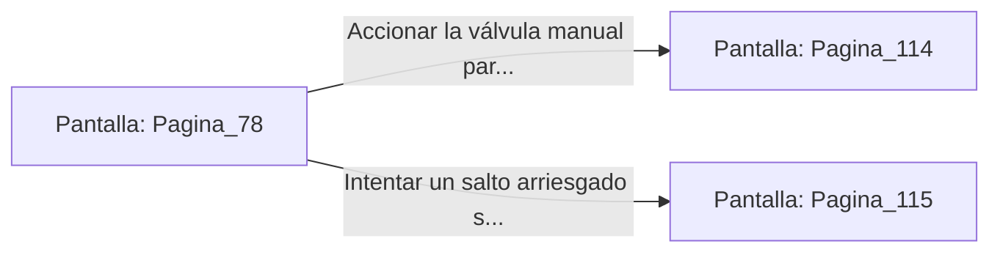

# 📺 Nodo Pantalla: `Pagina_78`

[[Index|⬅️ Índice]] | Fichero Origen: [[sample_eligejuego-code_capitulo_05_mpl|📄 sample/eligejuego-code/capitulo_05.mpl]]

**Narrativa y Encabezado:**
> PÁGINA 78: LA PASARELA DE LAS CALDERAS
> 
> Avanzas por la angosta pasarela metálica suspendida sobre los tanques de combustión de la ciudadela. El calor ardiente que emana de los hornos hace chisporrotear el aire y empapa tu frente de sudor en cuestión de minutos.
> 
> A mitad de camino, un chorro de vapor a alta presión irrumpe de una tubería agrietada, bloqueando la pasarela. Un panel de purga manual se encuentra al alcance de tu mano a la izquierda.
> 
> Puedes accionar la válvula del panel para desviar el vapor o intentar cruzar de un salto la zona de descarga térmica.

## 📋 Desglose de Instrucciones de Opciones
### `OPCION "Accionar la válvula manual para desviar el chorro de vapor" CON_ACCION TRANSICIONAR_A Pagina_114`
* **Instrucción:** `OPCION` *(Manual: Mapea una entrada o botón interactivo de usuario. Vincular una acción como la invocación de una función C1, un método C2 o una transición C3.)*
* **Efecto de Control:** Dispara `TRANSICIONAR_A` hacia [[Pantalla_Pagina_114|📺 Pagina_114]]
### `OPCION "Intentar un salto arriesgado sobre la zona de descarga" CON_ACCION TRANSICIONAR_A Pagina_115`
* **Instrucción:** `OPCION` *(Manual: Mapea una entrada o botón interactivo de usuario. Vincular una acción como la invocación de una función C1, un método C2 o una transición C3.)*
* **Efecto de Control:** Dispara `TRANSICIONAR_A` hacia [[Pantalla_Pagina_115|📺 Pagina_115]]

## 📊 Diagrama de Flujo e Interacción (Mermaid)

