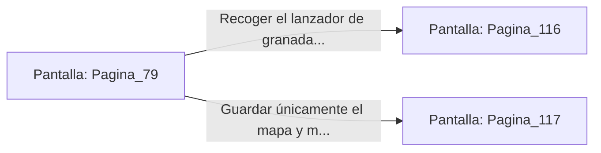

# 📺 Nodo Pantalla: `Pagina_79`

[[Index|⬅️ Índice]] | Fichero Origen: [[sample_eligejuego-code_capitulo_05_mpl|📄 sample/eligejuego-code/capitulo_05.mpl]]

**Narrativa y Encabezado:**
> PÁGINA 79: EL TRAGALUZ DEL ARMERÍO
> 
> Forzaste el cierre del tragaluz con tu estaca rúnica y te descolgaste al interior del armerío secundario. En el lugar reinaba un silencio sepulcral entre bastidores llenos de rifles y munición arcana.
> 
> En un estante blindado descubres un lanzador de granadas de concusión y un mapa de las galerías subterráneas.

## 📋 Desglose de Instrucciones de Opciones
### `OPCION "Recoger el lanzador de granadas y dirigirte a las galerías" CON_ACCION TRANSICIONAR_A Pagina_116`
* **Instrucción:** `OPCION` *(Manual: Mapea una entrada o botón interactivo de usuario. Vincular una acción como la invocación de una función C1, un método C2 o una transición C3.)*
* **Efecto de Control:** Dispara `TRANSICIONAR_A` hacia [[Pantalla_Pagina_116|📺 Pagina_116]]
### `OPCION "Guardar únicamente el mapa y mantener el perfil bajo" CON_ACCION TRANSICIONAR_A Pagina_117`
* **Instrucción:** `OPCION` *(Manual: Mapea una entrada o botón interactivo de usuario. Vincular una acción como la invocación de una función C1, un método C2 o una transición C3.)*
* **Efecto de Control:** Dispara `TRANSICIONAR_A` hacia [[Pantalla_Pagina_117|📺 Pagina_117]]

## 📊 Diagrama de Flujo e Interacción (Mermaid)

