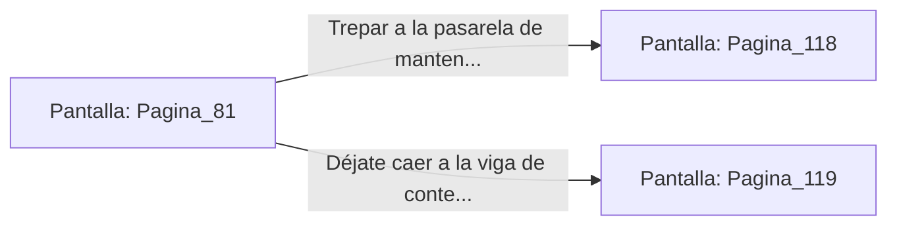

# 📺 Nodo Pantalla: `Pagina_81`

[[Index|⬅️ Índice]] | Fichero Origen: [[sample_eligejuego-code_capitulo_05_mpl|📄 sample/eligejuego-code/capitulo_05.mpl]]

**Narrativa y Encabezado:**
> PÁGINA 81: ESCAPE POR LA ESCOTILLA
> 
> Abres a patadas la escotilla superior del ascensor y te encaramas al techo justo a tiempo. Un segundo después, una carga explosiva colocada en las puertas de la cabina detona, destruyendo el habitáculo interior por completo.
> 
> Sujeto a los cables de elevación, miras hacia arriba y contemplas la estructura del pozo. Una pasarela de mantenimiento con una puerta rúnica se encuentra a apenas tres metros sobre tu cabeza.
> 
> Trepas por los cables con esfuerzo para alcanzar la pasarela antes de que las llamas del ascensor alcancen el mecanismo superior.

## 📋 Desglose de Instrucciones de Opciones
### `OPCION "Trepar a la pasarela de mantenimiento y cruzar la puerta rúnica" CON_ACCION TRANSICIONAR_A Pagina_118`
* **Instrucción:** `OPCION` *(Manual: Mapea una entrada o botón interactivo de usuario. Vincular una acción como la invocación de una función C1, un método C2 o una transición C3.)*
* **Efecto de Control:** Dispara `TRANSICIONAR_A` hacia [[Pantalla_Pagina_118|📺 Pagina_118]]
### `OPCION "Déjate caer a la viga de contención inferior" CON_ACCION TRANSICIONAR_A Pagina_119`
* **Instrucción:** `OPCION` *(Manual: Mapea una entrada o botón interactivo de usuario. Vincular una acción como la invocación de una función C1, un método C2 o una transición C3.)*
* **Efecto de Control:** Dispara `TRANSICIONAR_A` hacia [[Pantalla_Pagina_119|📺 Pagina_119]]

## 📊 Diagrama de Flujo e Interacción (Mermaid)

