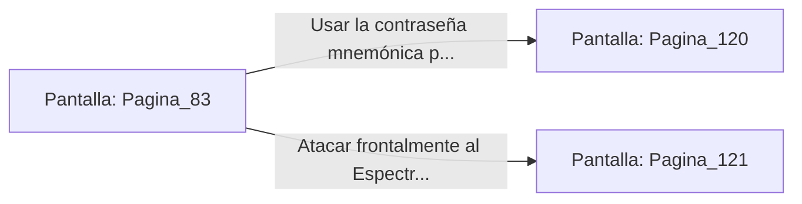

# 📺 Nodo Pantalla: `Pagina_83`

[[Index|⬅️ Índice]] | Fichero Origen: [[sample_eligejuego-code_capitulo_05_mpl|📄 sample/eligejuego-code/capitulo_05.mpl]]

**Narrativa y Encabezado:**
> PÁGINA 83: LA FOSA DE LOS JURAMENTOS
> 
> Llegas al borde de una colosal sima subterránea rodeada por estatuas gigantescas de los antiguos jueces de Aethelgard. En el centro de la fosa, flotando sobre una plataforma de energía, brilla el Primer Sello de Fase protegido por un aura espectral.
> 
> La figura translúcida del Espectro Temporal de primera generación se materializa sobre el sello, empuñando un mandoble de luz estelar. Tu Brazal recuerda la contraseña de desactivación que obtuviste en el Gran Archivo.
> 
> Tienes dos opciones: pronunciar la contraseña para anular el escudo del espectro durante diez segundos o intentar destruirlo directamente con tu armamento.

## 📋 Desglose de Instrucciones de Opciones
### `OPCION "Usar la contraseña mnemónica para anular el escudo del Espectro" CON_ACCION TRANSICIONAR_A Pagina_120`
* **Instrucción:** `OPCION` *(Manual: Mapea una entrada o botón interactivo de usuario. Vincular una acción como la invocación de una función C1, un método C2 o una transición C3.)*
* **Efecto de Control:** Dispara `TRANSICIONAR_A` hacia [[Pantalla_Pagina_120|📺 Pagina_120]]
### `OPCION "Atacar frontalmente al Espectro con tu armamento de fase" CON_ACCION TRANSICIONAR_A Pagina_121`
* **Instrucción:** `OPCION` *(Manual: Mapea una entrada o botón interactivo de usuario. Vincular una acción como la invocación de una función C1, un método C2 o una transición C3.)*
* **Efecto de Control:** Dispara `TRANSICIONAR_A` hacia [[Pantalla_Pagina_121|📺 Pagina_121]]

## 📊 Diagrama de Flujo e Interacción (Mermaid)

