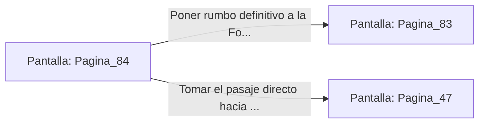

# 📺 Nodo Pantalla: `Pagina_84`

[[Index|⬅️ Índice]] | Fichero Origen: [[sample_eligejuego-code_capitulo_05_mpl|📄 sample/eligejuego-code/capitulo_05.mpl]]

**Narrativa y Encabezado:**
> PÁGINA 84: BÚSQUEDA TÁCTICA ADICIONAL
> 
> Continúas examinando los archivos para obtener planos de los otros sellos. Descubres que el Segundo Sello se encuentra en los Jardines Sintéticos y el Tercero en la Torre del Trono.
> 
> Con toda la información en tu memoria, abandonas la terminal para dirigirte hacia la Fosa.

## 📋 Desglose de Instrucciones de Opciones
### `OPCION "Poner rumbo definitivo a la Fosa de los Juramentos" CON_ACCION TRANSICIONAR_A Pagina_83`
* **Instrucción:** `OPCION` *(Manual: Mapea una entrada o botón interactivo de usuario. Vincular una acción como la invocación de una función C1, un método C2 o una transición C3.)*
* **Efecto de Control:** Dispara `TRANSICIONAR_A` hacia [[Pantalla_Pagina_83|📺 Pagina_83]]
### `OPCION "Tomar el pasaje directo hacia los Jardines Sintéticos" CON_ACCION TRANSICIONAR_A Pagina_47`
* **Instrucción:** `OPCION` *(Manual: Mapea una entrada o botón interactivo de usuario. Vincular una acción como la invocación de una función C1, un método C2 o una transición C3.)*
* **Efecto de Control:** Dispara `TRANSICIONAR_A` hacia [[Pantalla_Pagina_47|📺 Pagina_47]]

## 📊 Diagrama de Flujo e Interacción (Mermaid)

