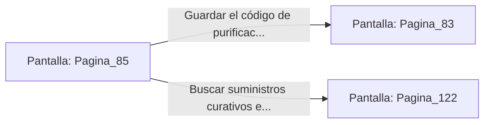

# 📺 Nodo Pantalla: `Pagina_85`

[[Index|⬅️ Índice]] | Fichero Origen: [[sample_eligejuego-code_capitulo_05_mpl|📄 sample/eligejuego-code/capitulo_05.mpl]]

**Narrativa y Encabezado:**
> PÁGINA 85: LA FÓRMULA DE PURIFICACIÓN
> 
> Investigas los registros arcanos y consigues sintetizar un código de purificación en tu Brazal, capaz de debilitar el vínculo mental entre Malakor y el Núcleo de Éter cuando llegue el enfrentamiento final.

## 📋 Desglose de Instrucciones de Opciones
### `OPCION "Guardar el código de purificación y avanzar a la Fosa" CON_ACCION TRANSICIONAR_A Pagina_83`
* **Instrucción:** `OPCION` *(Manual: Mapea una entrada o botón interactivo de usuario. Vincular una acción como la invocación de una función C1, un método C2 o una transición C3.)*
* **Efecto de Control:** Dispara `TRANSICIONAR_A` hacia [[Pantalla_Pagina_83|📺 Pagina_83]]
### `OPCION "Buscar suministros curativos en los anaqueles del archivo" CON_ACCION TRANSICIONAR_A Pagina_122`
* **Instrucción:** `OPCION` *(Manual: Mapea una entrada o botón interactivo de usuario. Vincular una acción como la invocación de una función C1, un método C2 o una transición C3.)*
* **Efecto de Control:** Dispara `TRANSICIONAR_A` hacia [[Pantalla_Pagina_122|📺 Pagina_122]]

## 📊 Diagrama de Flujo e Interacción (Mermaid)

