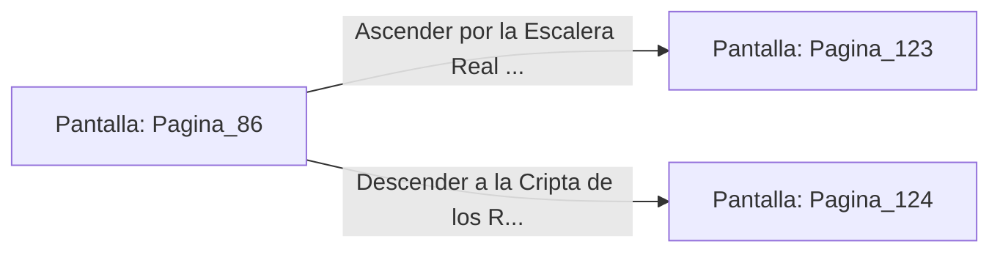

# 📺 Nodo Pantalla: `Pagina_86`

[[Index|⬅️ Índice]] | Fichero Origen: [[sample_eligejuego-code_capitulo_05_mpl|📄 sample/eligejuego-code/capitulo_05.mpl]]

**Narrativa y Encabezado:**
> PÁGINA 86: EL TEMPLO DE LA CONVERGENCIA
> 
> Entras en una enorme basílica de mármol blanco cuyas bóvedas están cubiertas por frescos que narran la creación del Cronoclave. En el altar central, una columna de luz dorada conecta el suelo con el techo de la ciudadela.
> 
> Sientes que el poder de la luz energiza los sistemas de tu Brazal de Convergencia, restaurando las funciones avanzadas de tu escudero cuántico.
> 
> Al fondo del templo se abren dos caminos: la Escalera Real que sube al trono o la Cripta de los Reyes Olvidados.

## 📋 Desglose de Instrucciones de Opciones
### `OPCION "Ascender por la Escalera Real hacia la sala del trono" CON_ACCION TRANSICIONAR_A Pagina_123`
* **Instrucción:** `OPCION` *(Manual: Mapea una entrada o botón interactivo de usuario. Vincular una acción como la invocación de una función C1, un método C2 o una transición C3.)*
* **Efecto de Control:** Dispara `TRANSICIONAR_A` hacia [[Pantalla_Pagina_123|📺 Pagina_123]]
### `OPCION "Descender a la Cripta de los Reyes Olvidados" CON_ACCION TRANSICIONAR_A Pagina_124`
* **Instrucción:** `OPCION` *(Manual: Mapea una entrada o botón interactivo de usuario. Vincular una acción como la invocación de una función C1, un método C2 o una transición C3.)*
* **Efecto de Control:** Dispara `TRANSICIONAR_A` hacia [[Pantalla_Pagina_124|📺 Pagina_124]]

## 📊 Diagrama de Flujo e Interacción (Mermaid)

