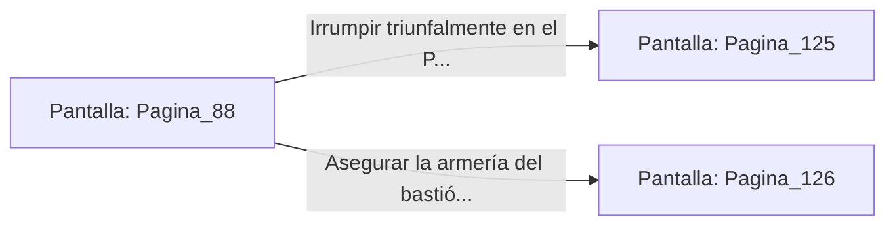

# 📺 Nodo Pantalla: `Pagina_88`

[[Index|⬅️ Índice]] | Fichero Origen: [[sample_eligejuego-code_capitulo_05_mpl|📄 sample/eligejuego-code/capitulo_05.mpl]]

**Narrativa y Encabezado:**
> PÁGINA 88: HACIA EL BASTIÓN CON EQUIPO DE REY
> 
> Empuñando el estoque de fase de luz y protegido por el escudo cuántico, caminas con paso firme hacia las puertas del Bastión de Guerra. La guardia de élite de Malakor, al reconocer las reliquias de los Antiguos Reyes, retrocede momentáneamente presa del pánico.
> 
> Aprovechas su vacilación para descargar una ráfaga de energía con el estoque, abriendo una brecha decisiva en la línea defensiva enemiga.
> 
> Con la entrada despejada, puedes irrumpir en el patio central o asegurar primero la armería del bastión.

## 📋 Desglose de Instrucciones de Opciones
### `OPCION "Irrumpir triunfalmente en el Patio Central del Bastión" CON_ACCION TRANSICIONAR_A Pagina_125`
* **Instrucción:** `OPCION` *(Manual: Mapea una entrada o botón interactivo de usuario. Vincular una acción como la invocación de una función C1, un método C2 o una transición C3.)*
* **Efecto de Control:** Dispara `TRANSICIONAR_A` hacia [[Pantalla_Pagina_125|📺 Pagina_125]]
### `OPCION "Asegurar la armería del bastión para cortar suministros enemigos" CON_ACCION TRANSICIONAR_A Pagina_126`
* **Instrucción:** `OPCION` *(Manual: Mapea una entrada o botón interactivo de usuario. Vincular una acción como la invocación de una función C1, un método C2 o una transición C3.)*
* **Efecto de Control:** Dispara `TRANSICIONAR_A` hacia [[Pantalla_Pagina_126|📺 Pagina_126]]

## 📊 Diagrama de Flujo e Interacción (Mermaid)

