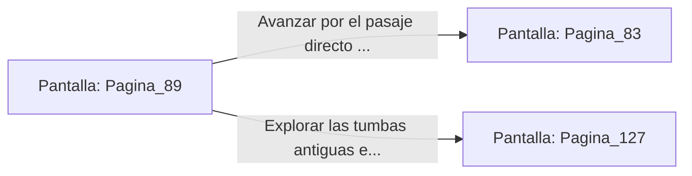

# 📺 Nodo Pantalla: `Pagina_89`

[[Index|⬅️ Índice]] | Fichero Origen: [[sample_eligejuego-code_capitulo_05_mpl|📄 sample/eligejuego-code/capitulo_05.mpl]]

**Narrativa y Encabezado:**
> PÁGINA 89: PRUEBA DE ARMAS EN LAS CATACUMBAS
> 
> Desciendes a las catacumbas para probar la potencia de tu nuevo armamento. Un grupo de necro-autómatas surge de la penumbra, pero tu estoque de fase corta sus blindajes como si fuesen de papel.
> 
> Satisfecho con el rendimiento de las reliquias, buscas el pasaje que conecta directamente con la Fosa de los Juramentos.

## 📋 Desglose de Instrucciones de Opciones
### `OPCION "Avanzar por el pasaje directo hacia la Fosa de los Juramentos" CON_ACCION TRANSICIONAR_A Pagina_83`
* **Instrucción:** `OPCION` *(Manual: Mapea una entrada o botón interactivo de usuario. Vincular una acción como la invocación de una función C1, un método C2 o una transición C3.)*
* **Efecto de Control:** Dispara `TRANSICIONAR_A` hacia [[Pantalla_Pagina_83|📺 Pagina_83]]
### `OPCION "Explorar las tumbas antiguas en busca de anillos arcanos" CON_ACCION TRANSICIONAR_A Pagina_127`
* **Instrucción:** `OPCION` *(Manual: Mapea una entrada o botón interactivo de usuario. Vincular una acción como la invocación de una función C1, un método C2 o una transición C3.)*
* **Efecto de Control:** Dispara `TRANSICIONAR_A` hacia [[Pantalla_Pagina_127|📺 Pagina_127]]

## 📊 Diagrama de Flujo e Interacción (Mermaid)

