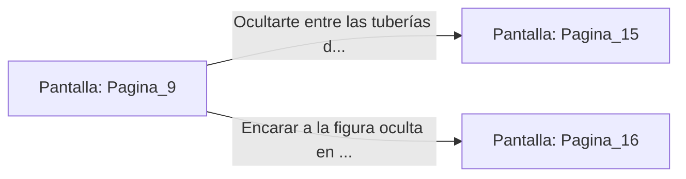

# 📺 Nodo Pantalla: `Pagina_9`

[[Index|⬅️ Índice]] | Fichero Origen: [[sample_eligejuego-code_capitulo_01_mpl|📄 sample/eligejuego-code/capitulo_01.mpl]]

**Narrativa y Encabezado:**
> PÁGINA 9: EL SECTOR INFERIOR DE MANTENIMIENTO
> 
> Bajas por la escala de hierro sintiendo cómo las vibraciones del complejo hacen temblar cada peldaño. El aire abajo es denso y caliente, saturado de un olor a aceite quemado y ozono que dificulta la respiración. Al tocar el suelo de rejilla metálica, te das cuenta de que estás sobre los depósitos de refrigerante de la ciudadela.
> 
> Bajo tus pies, enormes turbinas giran a velocidades vertiginosas, impulsando los fluidos energéticos que mantienen con vida el complejo. A lo lejos, a través de la penumbra de las tuberías, alcanzas a divisar una silueta patrullando con una linterna de éter.
> 
> Tienes dos opciones: intentar ocultarte entre la densa red de tuberías de vapor o avanzar de frente encarando a la figura desconocida.

## 📋 Desglose de Instrucciones de Opciones
### `OPCION "Ocultarte entre las tuberías de vapor" CON_ACCION TRANSICIONAR_A Pagina_15`
* **Instrucción:** `OPCION` *(Manual: Mapea una entrada o botón interactivo de usuario. Vincular una acción como la invocación de una función C1, un método C2 o una transición C3.)*
* **Efecto de Control:** Dispara `TRANSICIONAR_A` hacia [[Pantalla_Pagina_15|📺 Pagina_15]]
### `OPCION "Encarar a la figura oculta en la penumbra" CON_ACCION TRANSICIONAR_A Pagina_16`
* **Instrucción:** `OPCION` *(Manual: Mapea una entrada o botón interactivo de usuario. Vincular una acción como la invocación de una función C1, un método C2 o una transición C3.)*
* **Efecto de Control:** Dispara `TRANSICIONAR_A` hacia [[Pantalla_Pagina_16|📺 Pagina_16]]

## 📊 Diagrama de Flujo e Interacción (Mermaid)

