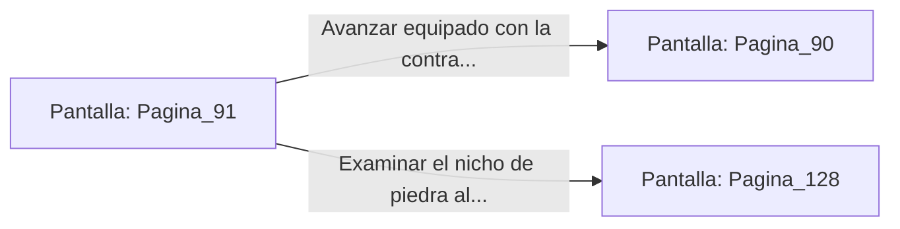

# 📺 Nodo Pantalla: `Pagina_91`

[[Index|⬅️ Índice]] | Fichero Origen: [[sample_eligejuego-code_capitulo_06_mpl|📄 sample/eligejuego-code/capitulo_06.mpl]]

**Narrativa y Encabezado:**
> PÁGINA 91: LAS INSCRIPCIONES DE LA GALERÍA
> 
> Te detienes a examinar las runas doradas grabadas en las paredes de arenisca de la galería secreta. El Brazal de Convergencia proyecta una traducción simultánea que revela pasajes olvidados sobre la arquitectura original de Aethelgard.
> 
> Las inscripciones relatan cómo el primer rey construyó una serie de conductos de drenaje rúnico capaces de purgar la radiación de éter en caso de inestabilidad del Núcleo. Además, se menciona la existencia de una contraseña maestra para los autómatas del Patio de Armas.
> 
> Con estos conocimientos archivados en la memoria de tu dispositivo, continúas por el pasillo directo hacia el Nivel de los Calderos.

## 📋 Desglose de Instrucciones de Opciones
### `OPCION "Avanzar equipado con la contraseña maestra hacia el Nivel de los Calderos" CON_ACCION TRANSICIONAR_A Pagina_90`
* **Instrucción:** `OPCION` *(Manual: Mapea una entrada o botón interactivo de usuario. Vincular una acción como la invocación de una función C1, un método C2 o una transición C3.)*
* **Efecto de Control:** Dispara `TRANSICIONAR_A` hacia [[Pantalla_Pagina_90|📺 Pagina_90]]
### `OPCION "Examinar el nicho de piedra al final de las inscripciones" CON_ACCION TRANSICIONAR_A Pagina_128`
* **Instrucción:** `OPCION` *(Manual: Mapea una entrada o botón interactivo de usuario. Vincular una acción como la invocación de una función C1, un método C2 o una transición C3.)*
* **Efecto de Control:** Dispara `TRANSICIONAR_A` hacia [[Pantalla_Pagina_128|📺 Pagina_128]]

## 📊 Diagrama de Flujo e Interacción (Mermaid)

