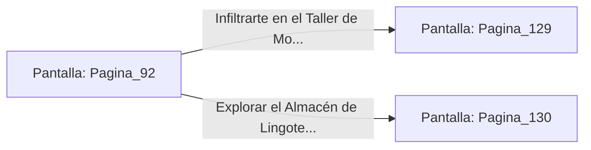

# 📺 Nodo Pantalla: `Pagina_92`

[[Index|⬅️ Índice]] | Fichero Origen: [[sample_eligejuego-code_capitulo_06_mpl|📄 sample/eligejuego-code/capitulo_06.mpl]]

**Narrativa y Encabezado:**
> PÁGINA 92: RUMBO A LAS FORJAS PESADAS
> 
> Asciendes por la rampa principal rodeando los depósitos de escoria alquímica. El calor es sofocante y el martilleo distante de los yunques mecánicos resuena con un ritmo atronador.
> 
> Llegas a una bifurcación iluminada por hornos de fundición: a la izquierda se accede al taller de montaje de autómatas; a la derecha, al almacén de lingotes de éter.

## 📋 Desglose de Instrucciones de Opciones
### `OPCION "Infiltrarte en el Taller de Montaje de Autómatas" CON_ACCION TRANSICIONAR_A Pagina_129`
* **Instrucción:** `OPCION` *(Manual: Mapea una entrada o botón interactivo de usuario. Vincular una acción como la invocación de una función C1, un método C2 o una transición C3.)*
* **Efecto de Control:** Dispara `TRANSICIONAR_A` hacia [[Pantalla_Pagina_129|📺 Pagina_129]]
### `OPCION "Explorar el Almacén de Lingotes de Éter" CON_ACCION TRANSICIONAR_A Pagina_130`
* **Instrucción:** `OPCION` *(Manual: Mapea una entrada o botón interactivo de usuario. Vincular una acción como la invocación de una función C1, un método C2 o una transición C3.)*
* **Efecto de Control:** Dispara `TRANSICIONAR_A` hacia [[Pantalla_Pagina_130|📺 Pagina_130]]

## 📊 Diagrama de Flujo e Interacción (Mermaid)

