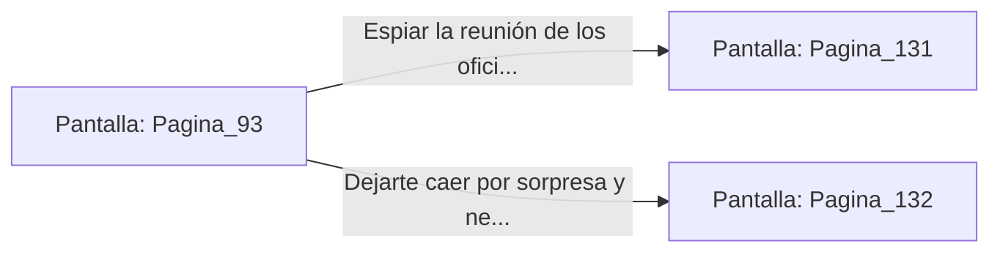

# 📺 Nodo Pantalla: `Pagina_93`

[[Index|⬅️ Índice]] | Fichero Origen: [[sample_eligejuego-code_capitulo_06_mpl|📄 sample/eligejuego-code/capitulo_06.mpl]]

**Narrativa y Encabezado:**
> PÁGINA 93: LOS TÚNELES DE VENTILACIÓN LATERALES
> 
> Te introduces en un conducto secundario de ventilación tallado directamente en la roca viva. El aire frío circula con fuerza desde las capas superiores, ofreciéndote un alivio reconfortante tras el sofocante calor de los niveles inferiores.
> 
> A mitad de camino, encuentras una parrilla de extracción que da a una sala de mapas tácticos donde dos oficiales de Malakor discuten el despliegue de las tropas.
> 
> Puedes espiar sus planes desde la altura de la parrilla o abrir silenciosamente el enganche para dejarte caer sobre ellos por sorpresa.

## 📋 Desglose de Instrucciones de Opciones
### `OPCION "Espiar la reunión de los oficiales desde la parrilla de ventilación" CON_ACCION TRANSICIONAR_A Pagina_131`
* **Instrucción:** `OPCION` *(Manual: Mapea una entrada o botón interactivo de usuario. Vincular una acción como la invocación de una función C1, un método C2 o una transición C3.)*
* **Efecto de Control:** Dispara `TRANSICIONAR_A` hacia [[Pantalla_Pagina_131|📺 Pagina_131]]
### `OPCION "Dejarte caer por sorpresa y neutralizar a los dos oficiales" CON_ACCION TRANSICIONAR_A Pagina_132`
* **Instrucción:** `OPCION` *(Manual: Mapea una entrada o botón interactivo de usuario. Vincular una acción como la invocación de una función C1, un método C2 o una transición C3.)*
* **Efecto de Control:** Dispara `TRANSICIONAR_A` hacia [[Pantalla_Pagina_132|📺 Pagina_132]]

## 📊 Diagrama de Flujo e Interacción (Mermaid)

