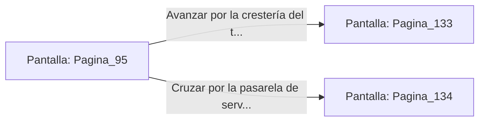

# 📺 Nodo Pantalla: `Pagina_95`

[[Index|⬅️ Índice]] | Fichero Origen: [[sample_eligejuego-code_capitulo_06_mpl|📄 sample/eligejuego-code/capitulo_06.mpl]]

**Narrativa y Encabezado:**
> PÁGINA 95: LOS TEJADOS DEL PALACIO
> 
> Te encaramas a los contrafuertes de mármol y alcanzas los amplios tejados de pizarra negra del Palacio Central. La tormenta de éter ruge sobre tu cabeza, tiñendo las nubes con destellos de un violeta eléctrico impresionante.
> 
> Desde esta altura privilegiada dominas toda la fortificación. Divisas la cúpula blindada que protege la Sala del Trono y una pasarela de servicio que comunica los tejados con el Gran Campanario.
> 
> Tienes la opción de avanzar sigilosamente por la crestería del tejado hacia la cúpula o cruzar por la pasarela hacia el Gran Campanario.

## 📋 Desglose de Instrucciones de Opciones
### `OPCION "Avanzar por la crestería del tejado rumbo a la cúpula de la Sala del Trono" CON_ACCION TRANSICIONAR_A Pagina_133`
* **Instrucción:** `OPCION` *(Manual: Mapea una entrada o botón interactivo de usuario. Vincular una acción como la invocación de una función C1, un método C2 o una transición C3.)*
* **Efecto de Control:** Dispara `TRANSICIONAR_A` hacia [[Pantalla_Pagina_133|📺 Pagina_133]]
### `OPCION "Cruzar por la pasarela de servicio hacia el Gran Campanario" CON_ACCION TRANSICIONAR_A Pagina_134`
* **Instrucción:** `OPCION` *(Manual: Mapea una entrada o botón interactivo de usuario. Vincular una acción como la invocación de una función C1, un método C2 o una transición C3.)*
* **Efecto de Control:** Dispara `TRANSICIONAR_A` hacia [[Pantalla_Pagina_134|📺 Pagina_134]]

## 📊 Diagrama de Flujo e Interacción (Mermaid)

