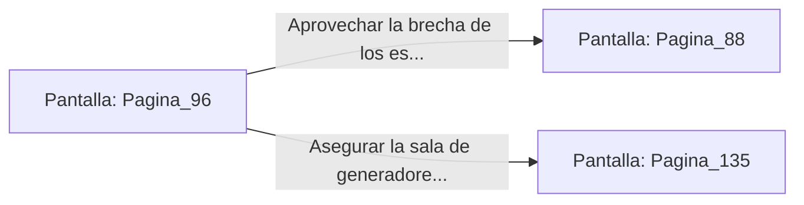

# 📺 Nodo Pantalla: `Pagina_96`

[[Index|⬅️ Índice]] | Fichero Origen: [[sample_eligejuego-code_capitulo_06_mpl|📄 sample/eligejuego-code/capitulo_06.mpl]]

**Narrativa y Encabezado:**
> PÁGINA 96: APAGADO DE LOS GENERADORES
> 
> Manipulas la consola principal de los Generadores Arcanos para detener la rotación de los anillos de bronce. La columna de fuego azul disminuye progresivamente su intensidad hasta extinguirse con un suspiro térmico.
> 
> En la lejanía se escucha el sonido de los escudos del Bastión Central al colapsar, abriendo una brecha decisiva en la defensa exterior.

## 📋 Desglose de Instrucciones de Opciones
### `OPCION "Aprovechar la brecha de los escudos e ir al Bastión Central" CON_ACCION TRANSICIONAR_A Pagina_88`
* **Instrucción:** `OPCION` *(Manual: Mapea una entrada o botón interactivo de usuario. Vincular una acción como la invocación de una función C1, un método C2 o una transición C3.)*
* **Efecto de Control:** Dispara `TRANSICIONAR_A` hacia [[Pantalla_Pagina_88|📺 Pagina_88]]
### `OPCION "Asegurar la sala de generadores antes de continuar" CON_ACCION TRANSICIONAR_A Pagina_135`
* **Instrucción:** `OPCION` *(Manual: Mapea una entrada o botón interactivo de usuario. Vincular una acción como la invocación de una función C1, un método C2 o una transición C3.)*
* **Efecto de Control:** Dispara `TRANSICIONAR_A` hacia [[Pantalla_Pagina_135|📺 Pagina_135]]

## 📊 Diagrama de Flujo e Interacción (Mermaid)

