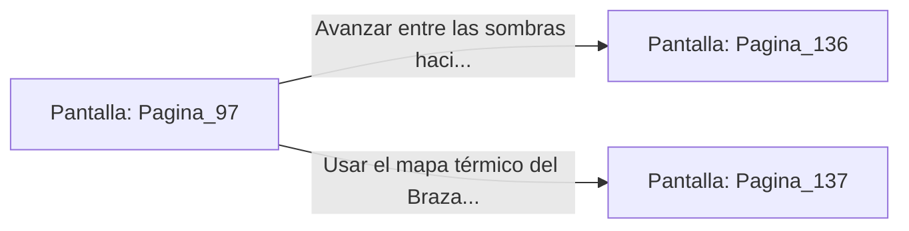

# 📺 Nodo Pantalla: `Pagina_97`

[[Index|⬅️ Índice]] | Fichero Origen: [[sample_eligejuego-code_capitulo_06_mpl|📄 sample/eligejuego-code/capitulo_06.mpl]]

**Narrativa y Encabezado:**
> PÁGINA 97: SOBRECARGA MASIVA
> 
> Fuerzas los reguladores de energía de la consola hasta el límite máximo. Los anillos de bronce comienzan a girar a revoluciones vertiginosas, emitiendo un chirrido agudo que hace vibrar el suelo de la cámara.
> 
> Sabiendo que la detonación es inminente, corres a toda prisa hacia la salida de emergencia. A tus espaldas, un fogonazo de plasma ilumina el pasillo mientras un apagón total sume a todo el sector en las sombras.
> 
> Con la base a oscuras y los sistemas de seguridad desactivados, buscas la ruta que conduce a los alojamientos de la Guardia de Élite.

## 📋 Desglose de Instrucciones de Opciones
### `OPCION "Avanzar entre las sombras hacia los alojamientos de la Guardia de Élite" CON_ACCION TRANSICIONAR_A Pagina_136`
* **Instrucción:** `OPCION` *(Manual: Mapea una entrada o botón interactivo de usuario. Vincular una acción como la invocación de una función C1, un método C2 o una transición C3.)*
* **Efecto de Control:** Dispara `TRANSICIONAR_A` hacia [[Pantalla_Pagina_136|📺 Pagina_136]]
### `OPCION "Usar el mapa térmico del Brazal para explorar la armería sin luz" CON_ACCION TRANSICIONAR_A Pagina_137`
* **Instrucción:** `OPCION` *(Manual: Mapea una entrada o botón interactivo de usuario. Vincular una acción como la invocación de una función C1, un método C2 o una transición C3.)*
* **Efecto de Control:** Dispara `TRANSICIONAR_A` hacia [[Pantalla_Pagina_137|📺 Pagina_137]]

## 📊 Diagrama de Flujo e Interacción (Mermaid)

