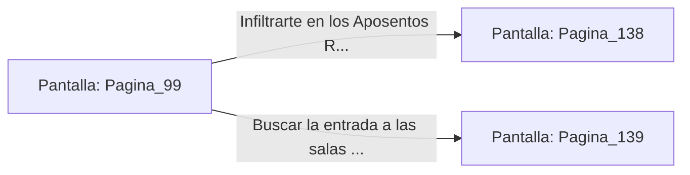

# 📺 Nodo Pantalla: `Pagina_99`

[[Index|⬅️ Índice]] | Fichero Origen: [[sample_eligejuego-code_capitulo_06_mpl|📄 sample/eligejuego-code/capitulo_06.mpl]]

**Narrativa y Encabezado:**
> PÁGINA 99: LA CORTINA DE VAPOR
> 
> Giras con fuerza la rueda de la válvula maestra. Una densa nube de vapor blanco a alta presión se libera al instante, inundando la nave inferior y cegando por completo a los ingenieros y guardias presentes.
> 
> Aprovechando la confusión y los gritos de alboroto, cruzas velozmente la pasarela superior sin que ningún disparo se dirija hacia ti.
> 
> Al cruzar el portón del fondo, alcanzas la galería de acceso a los Aposentos Reales, donde el aire vuelve a ser fresco y limpio.

## 📋 Desglose de Instrucciones de Opciones
### `OPCION "Infiltrarte en los Aposentos Reales" CON_ACCION TRANSICIONAR_A Pagina_138`
* **Instrucción:** `OPCION` *(Manual: Mapea una entrada o botón interactivo de usuario. Vincular una acción como la invocación de una función C1, un método C2 o una transición C3.)*
* **Efecto de Control:** Dispara `TRANSICIONAR_A` hacia [[Pantalla_Pagina_138|📺 Pagina_138]]
### `OPCION "Buscar la entrada a las salas de archivo privadas" CON_ACCION TRANSICIONAR_A Pagina_139`
* **Instrucción:** `OPCION` *(Manual: Mapea una entrada o botón interactivo de usuario. Vincular una acción como la invocación de una función C1, un método C2 o una transición C3.)*
* **Efecto de Control:** Dispara `TRANSICIONAR_A` hacia [[Pantalla_Pagina_139|📺 Pagina_139]]

## 📊 Diagrama de Flujo e Interacción (Mermaid)

