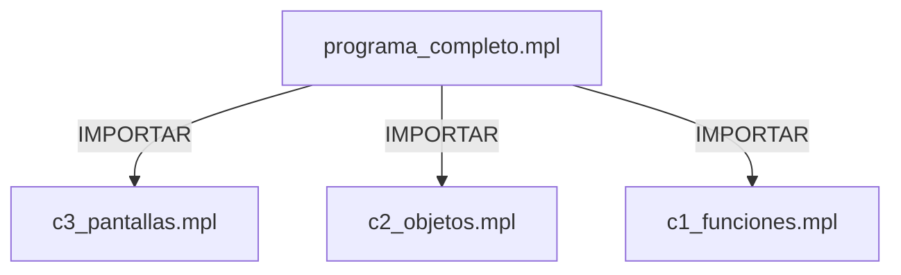

# 🗺️ Arquitectura e Índice de Bóveda Atómica: `programa_completo`

Bóveda navegable interactiva desglosada **instrucción por instrucción** con manual `man` integrado.

## 📁 Ficheros del Proyecto
* [[sample_programa_completo-code_c1_funciones_mpl|📄 sample/programa_completo-code/c1_funciones.mpl]] — *🧩 Módulo*
* [[sample_programa_completo-code_c2_objetos_mpl|📄 sample/programa_completo-code/c2_objetos.mpl]] — *🧩 Módulo*
* [[sample_programa_completo-code_c3_pantallas_mpl|📄 sample/programa_completo-code/c3_pantallas.mpl]] — *🧩 Módulo*
* [[sample_programa_completo_mpl|📄 sample/programa_completo.mpl]] — *🏰 Fachada Principal*

## 🖥️ Nodos Capa 3: Pantallas
* [[Pantalla_VistaPrincipal|📺 VistaPrincipal]] *(Origen: sample/programa_completo-code/c3_pantallas.mpl)*
* [[Pantalla_VistaSecundaria|📺 VistaSecundaria]] *(Origen: sample/programa_completo-code/c3_pantallas.mpl)*

## 🧱 Nodos Capa 2: Objetos Conceptuales
* [[Objeto_GestorRecursos|📦 GestorRecursos]] *(Origen: sample/programa_completo-code/c2_objetos.mpl)*

## ⚙️ Nodos Capa 1: Funciones
* [[Funcion_EjecutarPruebaC1|🛠️ EjecutarPruebaC1]] *(Origen: sample/programa_completo-code/c1_funciones.mpl)*

## 📊 Diagrama Topológico General (Mermaid)

