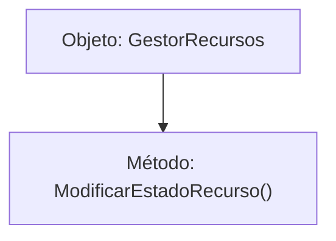

# 📦 Nodo Objeto Conceptual: `GestorRecursos`

[[Index|⬅️ Índice]] | Fichero Origen: [[sample_programa_completo-code_c2_objetos_mpl|📄 sample/programa_completo-code/c2_objetos.mpl]]

## ⚙️ Estado y Propiedades
* **`activo`**: `False`
* **`contador`**: `0`

## 🛠️ Métodos e Instrucciones Concretas Línea por Línea
### Método `ModificarEstadoRecurso()`
| N° | Instrucción Concreta | Explicación Semántica | 'man' Ficha |
| :--- | :--- | :--- | :--- |

## 📊 Diagrama de Estructura Interna (Mermaid)

