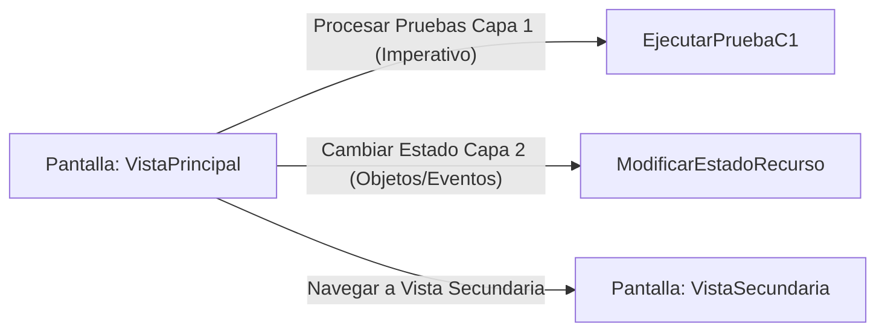

# 📺 Nodo Pantalla: `VistaPrincipal`

[[Index|⬅️ Índice]] | Fichero Origen: [[sample_programa_completo-code_c3_pantallas_mpl|📄 sample/programa_completo-code/c3_pantallas.mpl]]

**Encabezado Visual:** "MetsuOS Terminal v1.0 - Menu Principal"

## 📋 Desglose de Instrucciones de Opciones
### `OPCION "Procesar Pruebas Capa 1 (Imperativo)" CON_ACCION EjecutarPruebaC1`
* **Instrucción:** `OPCION` *(Manual: Mapea una entrada o botón interactivo de usuario. Vincular una acción como la invocación de una función C1, un método C2 o una transición C3.)*
* **Efecto de Control:** Invocación imperativa a [[Funcion_EjecutarPruebaC1|🛠️ EjecutarPruebaC1]]
### `OPCION "Cambiar Estado Capa 2 (Objetos/Eventos)" CON_ACCION ModificarEstadoRecurso`
* **Instrucción:** `OPCION` *(Manual: Mapea una entrada o botón interactivo de usuario. Vincular una acción como la invocación de una función C1, un método C2 o una transición C3.)*
* **Efecto de Control:** Ejecuta el método/acción `ModificarEstadoRecurso`
### `OPCION "Navegar a Vista Secundaria" CON_ACCION TRANSICIONAR_A VistaSecundaria`
* **Instrucción:** `OPCION` *(Manual: Mapea una entrada o botón interactivo de usuario. Vincular una acción como la invocación de una función C1, un método C2 o una transición C3.)*
* **Efecto de Control:** Dispara `TRANSICIONAR_A` hacia [[Pantalla_VistaSecundaria|📺 VistaSecundaria]] *(Manual: Primitiva de control de flujo UI. Emite un evento asíncrono al Event Loop para cambiar la vista activa a la pantalla de destino.)*

## 📊 Diagrama de Flujo e Interacción (Mermaid)

